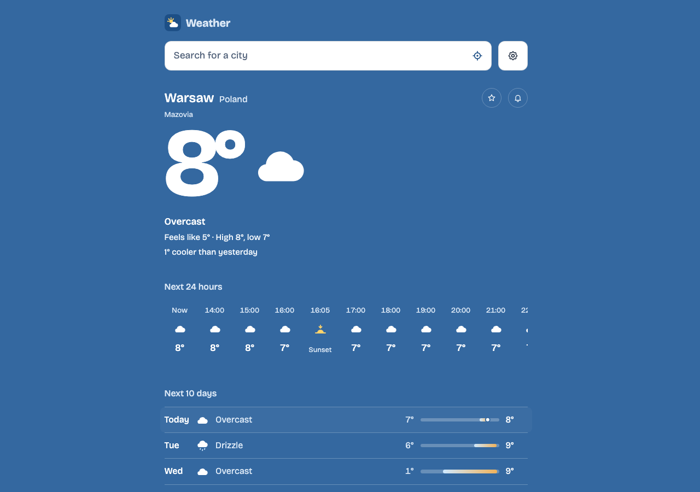
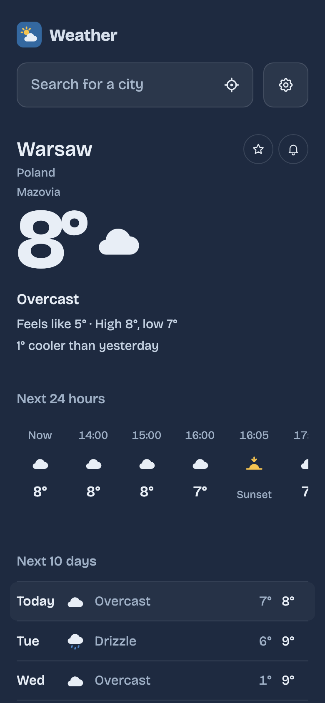
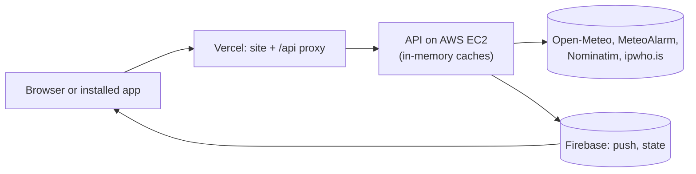

# Weather Forecast App

Current weather, the next 24 hours and a 10-day forecast for any place, with official European weather warnings, in 8
languages, installable and usable offline.

**Live demo:** <https://weather-app-three-rho-21.vercel.app>

<p>
  
  
</p>

## Features

- City search with autocomplete and keyboard navigation; shareable links that are the same in every language
  (`/weather/756135-warsaw`)
- Current conditions, an hourly strip with the chance of rain, a 10-day forecast with temperature range bars
- Detail tiles with 24-hour charts: precipitation, wind, humidity, air quality, UV, sunrise and sunset, pressure,
  visibility
- Official weather warnings for Europe (MeteoAlarm), in the issuer's own words
- Push notifications about warnings for chosen places (optional, Firebase)
- Up to 10 favourite cities, saved in the browser
- Weather at your location, with a city guessed from the IP address as a fallback
- 8 languages (en, de, fr, es, it, pl, uk, ru); °C or °F; light and dark themes
- Installable PWA that opens offline with the last loaded forecasts
- Accessible (WCAG 2.1 AA checked by axe) and private: no accounts, cookies, analytics or ads; a policy at `/privacy`

## Tech stack

| Layer    | Technology                                                                                    |
| -------- | --------------------------------------------------------------------------------------------- |
| Frontend | React 19, React Router 8, TypeScript, Vite 8, Workbox (PWA)                                   |
| Backend  | Node.js 24, Express 5, TypeScript, Zod                                                        |
| Data     | Open-Meteo (forecast, air quality, search), MeteoAlarm, Nominatim, ipwho.is                   |
| Push     | Firebase Cloud Messaging, Firestore (operational state), cron-job.org (scheduler)             |
| Hosting  | Vercel (site and `/api` proxy), AWS EC2 (API under systemd behind Caddy)                      |
| Quality  | Vitest, Testing Library, Supertest, Playwright, axe-core, ESLint, Prettier; GitHub Actions CI |

Data sources are credited where their terms ask: Open-Meteo and © OpenStreetMap in the footer, MeteoAlarm under the
warnings ([ADR 0004](docs/adr/0004-provider-limits.md)).

## Architecture



The browser talks only to our API (backend for frontend), which caches provider answers and guards their free limits.

| Read                                         | For                                                    |
| -------------------------------------------- | ------------------------------------------------------ |
| [docs/architecture.md](docs/architecture.md) | how each part works, and the key parameters            |
| [docs/adr/](docs/adr/README.md)              | why it is built this way, and what was rejected        |
| [CONTRIBUTING.md](CONTRIBUTING.md)           | set-up, checks, code rules, push set-up                |
| [docs/operations.md](docs/operations.md)     | monitoring, alerts, secrets, what is not verified live |
| [docs/deploy-aws.md](docs/deploy-aws.md)     | deploying the API, updates and rollback                |

## Project structure

```
packages/shared/   API contract and shared logic (@weather/shared)
server/            Express API: routes → services → providers
client/            React web app, service worker, Vercel middleware; e2e tests in client/e2e
deploy/vm/         The API's VM: setup.sh, deploy.sh, systemd unit
docs/              architecture, decision records, operations, deployment, openapi.json
```

## Getting started

Requires Node.js 24.22.2 or later, below 25 (`.nvmrc`; `nvm use`).

```bash
npm install
cp server/.env.example server/.env
npm run dev
```

- Frontend: http://localhost:5173
- API: http://localhost:3001/api/health

Push notifications are optional and need a free Firebase project:
[CONTRIBUTING.md](CONTRIBUTING.md#push-notifications-optional).

```bash
npm test           # unit and component tests
npm run test:e2e   # Playwright + axe on the production build (first: npx playwright install chromium)
npm run lint
npm run typecheck
npm run build
```

## API

Versioned in the path (`/api/v1`); within a version only compatible changes are made. The full description is
[`docs/openapi.json`](docs/openapi.json) ([browse it](https://petstore.swagger.io/?url=https://raw.githubusercontent.com/natasha-vardo-dev/weather-app/main/docs/openapi.json)), generated from the Zod schemas in `@weather/shared`
([details](docs/architecture.md#api-versions)).

| Method | Endpoint                                                 | Description                                        |
| ------ | -------------------------------------------------------- | -------------------------------------------------- |
| GET    | `/api/v1/locations?q=warsaw&limit=5`                     | Search places                                      |
| GET    | `/api/v1/locations/756135?lang=ru`                       | One place by id, named in a language               |
| GET    | `/api/v1/forecast?lat=52.23&lon=21.01&days=10`           | Current weather, next 24 hours, yesterday and days |
| GET    | `/api/v1/forecasts?places=52.23,21.01;50.06,19.94`       | Forecasts for up to 10 places at once              |
| GET    | `/api/v1/air-quality?lat=52.23&lon=21.01`                | Current air quality (European and US AQI)          |
| GET    | `/api/v1/alerts?lat=54.21&lon=21.74&lang=pl`             | Official warnings at a place (Europe, MeteoAlarm)  |
| GET    | `/api/v1/places/approximate?lang=ru`                     | The user's city guessed from their IP address      |
| GET    | `/api/v1/places/reverse?lat=52.25&lon=21.05&lang=ru`     | The place at the user's location                   |
| POST   | `/api/v1/push/topics`                                    | Subscribe a device to warnings for a place         |
| POST   | `/api/v1/client-errors`                                  | An error report from the browser                   |
| POST   | `/api/internal/alerts/notify`                            | Push new warnings (scheduler, bearer secret)       |
| GET    | `/api/internal/metrics`                                  | Cache and provider metrics (bearer secret)         |
| GET    | `/api/health`, `/api/health/quota`, `/api/health/notify` | Health checks for uptime monitors                  |

Errors: `{ "error": { "code": "INVALID_REQUEST", "message": "..." } }`. Requests are rate-limited per IP; over the limit
the answer is `429 RATE_LIMITED` with `Retry-After` ([limits](docs/architecture.md#key-parameters)).

## Deployment

- **Site:** Vercel, root directory `client`. `client/middleware.ts` forwards `/api/*` to the API with a shared secret
  and the user's IP, so the site and the API share one origin. Its variables:
  [docs/deploy-aws.md](docs/deploy-aws.md#6-the-site-and-the-scheduler).
- **API:** an AWS EC2 instance with its own IP, Node under systemd behind Caddy, deployed by hand over SSH
  ([docs/deploy-aws.md](docs/deploy-aws.md)). In production the server refuses to start with a missing or unsafe
  setting.
- **Monitoring:** four UptimeRobot monitors ([docs/operations.md](docs/operations.md)).

## Assumptions

- No accounts: favourites live in the browser and do not sync between devices.
- 10 days of forecast: Open-Meteo returns up to 16, but accuracy drops sharply after 10.
- Only temperature has a unit switch; wind stays in km/h.
- The 8 translations are machine-quality drafts that need native speakers before a real release.
- Warnings cover Europe only (MeteoAlarm's 39 countries); no banner means no warning was found, not a promise of calm
  weather.
- Free data sources and hosting only, so their limits are product requirements
  ([ADR 0004](docs/adr/0004-provider-limits.md)); the API host is free for the first 6 months, then about $10–12 a
  month ([ADR 0020](docs/adr/0020-api-on-aws-ec2.md)).
- Availability is best effort: one API instance, deployed by hand; a deploy is a few seconds without it.
- On an iPhone with the app already open, tapping a notification only brings the app forward
  ([ADR 0026](docs/adr/0026-push-delivery-details.md)).
- Not everything was verified on the deployed app: [the list](docs/operations.md#not-verified-live).

## Trade-offs and decisions

- **Backend for frontend:** one place to cache, guard provider limits and keep the client independent of the provider
  ([ADR 0001](docs/adr/0001-backend-for-frontend.md)).
- **City URLs by GeoNames id**, the same in every language and across providers
  ([ADR 0006](docs/adr/0006-place-urls-by-id.md)).
- **In-memory cache, no Redis** while there is one instance ([ADR 0022](docs/adr/0022-no-redis-while-one-instance.md)).
- **Monorepo with a shared contract package** used by the server and the client
  ([ADR 0002](docs/adr/0002-monorepo-shared-contract.md)).
- **EC2, not Render:** free Render shares outgoing addresses, and Open-Meteo, which limits per address, refused every
  forecast there ([ADR 0019](docs/adr/0019-api-on-oracle-free-vm.md), [ADR 0020](docs/adr/0020-api-on-aws-ec2.md)).

## What I would do next

- Deploy the API from `main` automatically
- A second forecast source (MET Norway) for when Open-Meteo fails or its free limits are outgrown
- A wind unit setting; accounts so favourites sync between devices
- More e2e scenarios (notifications, the service worker's update)
- With a second API instance: Redis for the cache and rate limits
