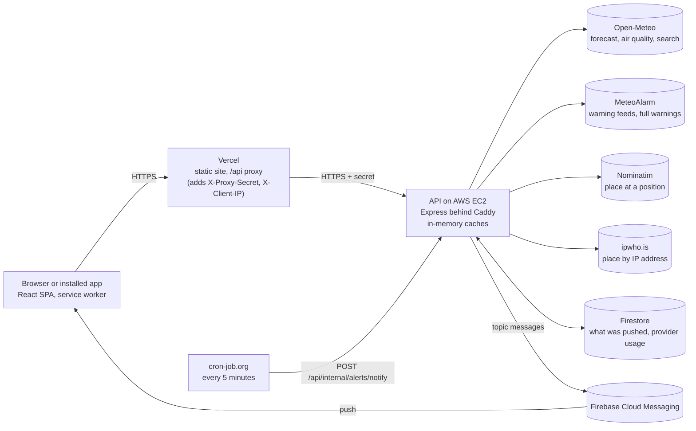
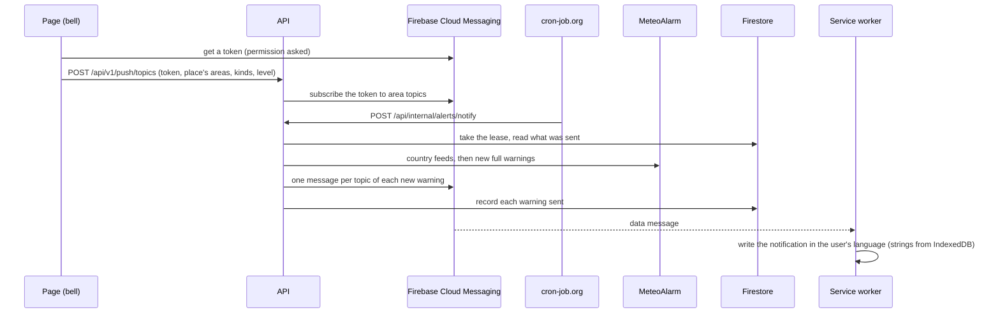

# Architecture

## Overview

A client–server application using the Backend for Frontend (BFF) pattern: the browser talks only to our backend, and
the backend talks to the weather and place providers.

This document describes how each part works: read the section for what you change, not the whole file. The reasons and
the options rejected are in [adr/](adr/README.md); how to set up, test and ship a change is in
[CONTRIBUTING.md](../CONTRIBUTING.md); running it in production is in [operations.md](operations.md).

A warning notification, from subscribing to the device:

## Contents

- **Server:** [Backend layers](#backend-layers) · [Caching](#caching) ·
  [Protecting the provider's limits](#protecting-the-providers-limits) · [Observability](#observability) ·
  [Privacy](#privacy) · [Reliability and security](#reliability-and-security)
- **Client:** [Frontend](#frontend) · [Same-named places in search](#same-named-places-in-search) ·
  [Favourites](#favourites) · [Languages](#languages) · [Temperature units](#temperature-units) ·
  [Header and settings](#header-and-settings) · [Current location](#current-location) · [Detail charts](#detail-charts)
  · [Installable app (PWA)](#installable-app-pwa)
- **Both:** [Push notifications about warnings](#push-notifications-about-warnings) ·
  [Weather warnings](#weather-warnings) · [API versions](#api-versions) · [Testing](#testing) ·
  [Shared package](#shared-package) · [Key parameters](#key-parameters)

## Where to start

| You change…                           | Read                                                                                                                               |
| ------------------------------------- | ---------------------------------------------------------------------------------------------------------------------------------- |
| a provider call, a cache, a limit     | [Caching](#caching), [Protecting the provider's limits](#protecting-the-providers-limits), [ADR 0004](adr/0004-provider-limits.md) |
| an endpoint or a schema in `shared`   | [API versions](#api-versions), [Shared package](#shared-package); then `npm run openapi`                                           |
| the page, a text, a setting           | [Frontend](#frontend), [Languages](#languages) (every text in all 8 locale files), [Header and settings](#header-and-settings)     |
| offline behaviour, the service worker | [Installable app (PWA)](#installable-app-pwa); check in a build (`npm run build && npm run preview -w client`)                     |
| warnings or push notifications        | [Weather warnings](#weather-warnings), [Push notifications](#push-notifications-about-warnings), [operations.md](operations.md)    |
| location, IP lookup, anything stored  | [Current location](#current-location), [Privacy](#privacy) and the `/privacy` page                                                 |
| hosting, secrets, deploys             | [Reliability and security](#reliability-and-security), [deploy-aws.md](deploy-aws.md), [operations.md](operations.md)              |

## Backend layers

- `routes/` validate input (Zod) and map HTTP to service calls.
- `services/` hold the logic: caching, key normalisation.
- `providers/` adapt one external API each to our interfaces (`WeatherProvider`, `AlertsProvider`, `ReverseGeocoder`,
  `IpLocator`).

Dependencies point downward only; tests replace the providers with fakes. Errors reach one handler in `app.ts` and go
out as `{ error: { code, message } }`, codes in `shared/src/errors.ts`.

Why: [ADR 0001](adr/0001-backend-for-frontend.md)

## Caching

Every provider answer is cached in memory by `TtlCache` (per instance; times in [Key parameters](#key-parameters)).

- **Keys:** coordinates rounded to 2 decimals (~1 km, `roundCoordinate` / `placeKey` in `shared`), and the provider is
  asked for the rounded point, so everyone in the cell shares one answer. Everything else that changes an answer
  (language, 10 or 16 days) is in the key.
- **One forecast call** returns yesterday, the next 24 hours and the days ahead; air quality is a separate Open-Meteo
  call and cache.
- **`TtlCache`:** a byte budget per cache with LRU eviction; up to 10% TTL jitter; one load per key (concurrent requests
  join it, failures are not cached); two stale windows: past the TTL an entry is served at once while it refreshes in
  the background, and after that only if the provider fails. Stale answers go out with a short `max-age`.
- **Restart** starts empty ([ADR 0022](adr/0022-no-redis-while-one-instance.md)).
- **Client side:** `api/queryCache.ts` keeps forecasts and air quality for their `max-age`, merging concurrent requests,
  so a place loaded by a favourite tile opens at once. When shown data is over an hour old, a "Forecast last updated"
  notice says so.

Why: [ADR 0003](adr/0003-in-memory-cache.md), [ADR 0023](adr/0023-cache-and-provider-budget-details.md)

## Protecting the provider's limits

Open-Meteo's free tier, counted per server IP, is the bottleneck. Layers, in order of effect:

1. **Caching and coalescing** (above).
2. **Batch forecasts:** `GET /api/v1/forecasts?places=…` loads up to 10 saved cities in one request through the same
   cache; the client batches tiles rendered together (`api/forecastBatch.ts`), and the service worker splits each
   batch into per-city copies for offline use (`src/sw/splitForecastBatch.ts`).
3. **Requests per IP** (`express-rate-limit`, `rateLimits.ts`), per endpoint group; `429 RATE_LIMITED` with
   `Retry-After`.
4. **Real client address:** the Vercel middleware adds `X-Proxy-Secret` and `X-Client-IP`; with `PROXY_SECRET` set the
   API answers 404 to anything without the secret, so the address cannot be forged by calling the VM directly.
5. **Provider calls per IP** (`LoadLimiter`): only uncached places count; a cached answer is never refused.
6. **A budget for the whole server** (`Metrics.budget`, in Open-Meteo's own units, `openMeteoWeight`): at 90% of a
   minute, hour or day limit new calls are refused with `503 SERVICE_BUSY` while cached answers still go out. ipwho.is
   has its own cap; Nominatim is queued at one call a second.

Why: [ADR 0004](adr/0004-provider-limits.md), [ADR 0005](adr/0005-hosting-same-origin-proxy.md),
[ADR 0023](adr/0023-cache-and-provider-budget-details.md)

## Observability

- **Logs:** JSON lines (pino) on stdout, kept by journald on the VM: one line per request (path without query, status,
  duration; no IP), provider errors with their cause, unhandled errors with the stack. `LOG_LEVEL=debug` adds every
  provider call.
- **Metrics** (`observability/metrics.ts`): cache hits and misses, provider calls per window against their limits,
  responses by status, rate-limited requests, requests per API version. Provider calls are counted by wrapping each
  adapter's `fetch` (`instrumentFetch`). Read at `GET /api/internal/metrics` (bearer `METRICS_SECRET`) and logged every
  15 minutes; provider usage is also saved to the state store.
- **Health:** `/api/health` (uptime, commit, whether the request came through the proxy), `/api/health/quota` (503 at
  80% of a limit), `/api/health/notify` (503 when the notifier has not succeeded for 30 minutes). What each alert means:
  [operations.md](operations.md).

Why: [ADR 0024](adr/0024-server-hardening-observability-privacy.md)

## Privacy

The policy is the page `/privacy` (`client/src/pages/PrivacyPage.tsx`, English only). It describes what the code does:
a new service that receives user data, or new data kept, means editing it and this section.

- No accounts, cookies, analytics or ads. Favourites, settings and the last loaded forecasts stay in the browser.
- The server passes places and searches to Open-Meteo and Nominatim as itself. It sees the IP for rate limiting (memory,
  a minute; never logged). Logs (places, searches, browser error reports) are kept 14 days by journald.
- The IP goes to ipwho.is only when the locate button was pressed and the browser found no position; the result is
  cached a day under a keyed hash of the address.
- With notifications on, the browser talks to Firebase; the server subscribes the token to topics without storing it.
  Firestore holds only warning ids, times and provider call counts.
- The font is part of the build; the Content-Security-Policy allows no Google hosts except the two Firebase ones push
  needs; an e2e test checks that fonts come only from the site.

Why: [ADR 0017](adr/0017-privacy-policy-and-own-font.md),
[ADR 0024](adr/0024-server-hardening-observability-privacy.md)

## Reliability and security

- **Configuration fails closed** (`server/src/config.ts`): with `NODE_ENV=production` the server refuses to start
  without `PROXY_SECRET` (32+ characters) or `TRUST_PROXY`, with `IP_SELF_LOOKUP`, with Firebase but no
  `ALERTS_NOTIFY_SECRET`, with a short secret or an unsafe `CORS_ORIGIN`, listing every problem and no secret's value.
  The Vercel middleware likewise refuses a bad `API_ORIGIN` or a missing `PROXY_SECRET`.
- **Provider answers are bounded and checked** (`providers/http.ts`): bodies are size-limited while read, Open-Meteo's
  output is parsed with `shared`'s schemas before caching, MeteoAlarm feeds are capped, and CAP documents are fetched
  only from `feeds.meteoalarm.org` over https without redirects.
- **Push changes are limited:** per IP, per token (by its hash) and by a global Firebase budget; at most 4 Firebase calls
  at once.
- **Operational state** (what the notifier sent, its lease, provider usage) is kept in Firestore when Firebase is
  configured, in memory otherwise ([ADR 0018](adr/0018-durable-operational-state.md)).
- **Shutdown** (`shutdown.ts`): on SIGTERM the server stops accepting connections, `/api/health` answers 503, requests
  under way get 10 s; systemd restarts a crashed process.
- **Browser errors:** an `ErrorBoundary` keeps the header working; render and uncaught errors go to
  `POST /api/v1/client-errors` (path with places masked, no query, a few per page) and are logged as warnings.
- **Headers:** the site's CSP, HSTS and the rest are in `client/vercel.json` (`vite preview` sends the same); e2e fails
  on any console error, so a CSP violation fails it. The API sends helmet's headers. Push is not exercised under the
  CSP in tests: check it after deploying.

Why: [ADR 0024](adr/0024-server-hardening-observability-privacy.md), [ADR 0014](adr/0014-client-error-reporting.md),
[ADR 0018](adr/0018-durable-operational-state.md)

## Frontend

SPA with React Router:

- `/` — start page (greeting, saved cities as cards);
- `/weather/756135-warsaw` — a city by its GeoNames id; the slug is for people only;
- `/weather/:lat,:lon?name=&country=` — a place without an id (found by location);
- `/privacy`; anything else — not found.

**Links** (`locationUrl.ts`, `placeRoute.ts`, `hooks/usePlaceRoute.ts`): the id identifies the city; the name comes
from a lookup by id in the reader's language, and the address is replaced with the canonical slug once the English name
is known. A saved city opens at once from its stored coordinates. Older coordinate links still open.

**Code layout:** pages in `pages/`, UI in `components/`, data loading in hooks (`useForecast`, `useAirQuality`,
`useAlerts`, `useLocationSearch`). Plain global CSS, one file per part in `client/src/styles/`, imported in order by
`styles/index.css`. Own SVG weather icons (`WeatherIcon.tsx`); `shared` only names the icon kind. Each navigation
sets `document.title` and moves focus to the heading.

**Data loading:** every request has a 15-second limit (`REQUEST_TIMEOUT_MS`). `useRevalidateOnReturn` reloads data
when the page comes back into view and the data is as old as the server keeps it; old data stays on screen meanwhile.
Nothing reloads on a timer except warnings.

Why: [ADR 0025](adr/0025-frontend-search-and-favourites-details.md)

## Push notifications about warnings

The server keeps no subscriptions ([ADR 0011](adr/0011-push-via-fcm-topics.md)); what was sent is kept in a
`StateStore` ([ADR 0018](adr/0018-durable-operational-state.md)). The flow is in the diagram under
[Overview](#overview).

- **Subscribing:** subscriptions are FCM topics per area, kind and minimum level (`PL1261.storm.orange`). The device
  sends its token to `POST /api/v1/push/topics`; the server works out the place's MeteoAlarm areas and subscribes it.
  The device keeps its own list in `localStorage` to change, undo and renew it; changes run one at a time in a queue.
- **The scheduled run** (`POST /api/internal/alerts/notify`, every 5 minutes from cron-job.org): takes a lease so two
  instances never both push, reads the saved state, reads every country feed, loads the full text of warnings not seen
  yet and sends them. Without saved state, the first read of each feed only records what is in force (warm-up).
- **Sending:** one notification per warning, to every topic it reaches. An update keeps the first version's `tag` and is
  pushed again only if its level rose. A warning counts as sent only once FCM accepted it; other failures retry on the
  next run. The payload is kept under FCM's 4 KB (`fitPayload`).
- **The device** (`public/push-sw.js`): messages are data-only; the service worker writes the notification in the
  user's language from strings the page stored in IndexedDB, falling back to a plainer one if that fails. A tap opens
  the city page, reusing an open window. On an iPhone with the app already running, iOS does not pass the tap on, so
  the app only comes forward.
- **The bell** by the city name sets storms or all warnings and the minimum level (default: storms from orange); all
  places with notifications on are also listed in the settings. No bell without Firebase config or where MeteoAlarm has
  no coverage (`covered` in `/api/v1/alerts`). The Firebase SDK loads only on demand.
- **Verified** end to end on 2026-11-01 on desktop browsers, Android and an iPhone Home Screen app with test pushes; the
  server logic and the service worker's rendering are unit-tested ([not verified live](operations.md#not-verified-live)).

Why: [ADR 0026](adr/0026-push-delivery-details.md)

## Same-named places in search

GeoNames has many places with one name. They are told apart by the first level that differs, never by adding a fixed
amount of detail:

- **Search:** islands are marked ("Rhodes · island"); suggestions that would read the same get the first admin level
  where they differ (`describePlaces`). Old and other names match too ("Kiev" finds Kyiv).
- **City page:** district and region on a line below the name, each left out when it repeats the name or has no
  translation.
- **Favourites:** only namesakes get the level that tells them apart.

Why: [ADR 0025](adr/0025-frontend-search-and-favourites-details.md)

## Favourites

Saved cities live in the browser (`localStorage`, `favorites:v1`), no accounts ([ADR 0007](adr/0007-favourites-in-browser.md)).

- **Rules in `shared`** (`favorites.ts`): matched by rounded coordinates, so a city is never saved twice; newest first;
  at most 10, and a full list blocks saving with a message rather than dropping one. `parseFavorites` validates storage.
- **Client:** `favoritesStore.ts` (plain functions) and `useFavorites` (`useSyncExternalStore`; the `storage` event
  syncs open tabs). The star by the city name saves and removes.
- **Display:** cards on the start page, a strip of tiles on city pages; their forecasts load in one batch and share
  the city page's cache.
- **Path to accounts:** keep the hook's API and swap its source for a server; merge the local list on first sign-in.

Why: [ADR 0025](adr/0025-frontend-search-and-favourites-details.md)

## Languages

Eight languages: en, de, fr, es, it, pl, uk, ru ([ADR 0016](adr/0016-fewer-languages.md)).

- **Default:** the first of `navigator.languages` supported (by base language), else English; a choice in the settings
  is saved and wins.
- **Translations:** one typed file per language in `client/src/i18n/locales/`, all bundled; the `Messages` type makes a
  missing key a compile error. No i18n library: plurals through `Intl.PluralRules`.
- **Numbers and dates** always through `Intl` (`num`, `deg`), so a screen has one digit system.
- **The API is language-neutral:** it returns condition keys and error codes; only place names take `lang`.
- **Place names** follow the UI language through a lookup by id (`useLocalizedPlace`); an id from a URL is trusted
  only if the place it names is at the same coordinates.
- **Right-to-left** support stays in the code (logical CSS properties, `isRtl`), though no current language needs it;
  e2e checks it with a forced `dir="rtl"`.

Why: [ADR 0008](adr/0008-languages-and-units.md), [ADR 0027](adr/0027-languages-units-and-charts-details.md)

## Temperature units

°F by default only when both the locale's region and the time zone are of the US or a few other °F countries
(`defaultTemperatureUnit` in `shared`); °C otherwise. The API and caches are in °C; the client converts, then rounds
(`useUnits().temp`). Wind stays in km/h.

Why: [ADR 0008](adr/0008-languages-and-units.md), [ADR 0027](adr/0027-languages-units-and-charts-details.md)

## Header and settings

- The logo above the search links to the start page.
- A gear next to the search opens the settings (a disclosure, not an ARIA menu): °C/°F, the language (our own listbox
  with type-ahead) and the list of places with warning notifications, each with a switch. Escape steps back one level.

Why: [ADR 0027](adr/0027-languages-units-and-charts-details.md)

## Current location

- **Coordinates** from the Geolocation API, only when the crosshair is pressed; rounded to ~1 km at once, so the exact
  position never reaches the URL, the server or logs.
- **Name:** `GET /api/v1/places/reverse` asks Nominatim (one call a second, own `User-Agent`, credited in the footer),
  then `PlaceService` matches the name to the nearest searched city within 25 km to get its id; otherwise the position
  opens without one. A saved city at the position wins without a request.
- **When the browser can't locate:** `GET /api/v1/places/approximate` guesses the city from the IP via ipwho.is
  (offered, not opened; marked "Approximate, by IP"). The IP comes from the proxy (`X-Client-IP`) or `TRUST_PROXY`.

Why: [ADR 0013](adr/0013-current-location.md), [ADR 0028](adr/0028-current-location-details.md)

## Detail charts

- Eight tiles below the 10-day forecast (`WeatherTiles`): precipitation, wind, humidity, air quality, UV, sunrise and
  sunset, pressure, visibility. A tile with hourly data opens a 24-hour chart below the grid; air quality opens its
  pollutants as bars against the WHO guidelines.
- Opening a panel from closed scrolls it into view only as far as needed, leaving 1.5rem below it
  (`scroll-margin-block-end` on `.detail-panel`), so it does not end flush with the screen's edge.
- The rules (UV level, pressure trend, dew point comfort…) are plain tested functions in `shared/details.ts`.
- Charts are plain SVG (`HourlyChart`), no library; screen readers get a hidden table.
- The data comes from the same forecast call; no extra provider calls.

Why: [ADR 0027](adr/0027-languages-units-and-charts-details.md)

## Installable app (PWA)

- **Tooling:** `vite-plugin-pwa` (Workbox `generateSW`) builds the manifest and service worker; icons are rendered from
  `client/public/logo.svg` at build time. There is no service worker in `npm run dev`.
- **Cached:** the app shell is precached; forecast, air quality and place names are NetworkFirst with a 6-second
  timeout, keeping the last 50 answers for a day (`client/vite.config.ts`). A 5xx from our server uses the saved copy
  too (`src/sw/savedCopyOnServerError.ts`). Search, location and warnings are not cached.
- **Banner:** when a saved copy is on screen, a status line says the forecast may be out of date: "You're offline" or
  "The weather server isn't responding" (`useStaleReason`, from the `X-From-Cache` mark the service worker adds).
- **Updates** install in the background and run from the next page load.
- **iOS:** the start page shows how to add the app to the Home Screen (`InstallHint`).

Why: [ADR 0009](adr/0009-offline-pwa.md), [ADR 0029](adr/0029-pwa-and-offline-details.md)

## Weather warnings

- **Source:** MeteoAlarm (CAP warnings of the national weather services of 39 European countries, one feed each, `FEEDS`) behind `AlertsProvider`
  (`providers/meteoAlarm.ts`).
- **Locating a place:** MeteoAlarm has no lookup by coordinates, so the server matches the place to region borders
  (`server/data/meteoalarm-regions.json.gz`, built by `server/scripts/buildAlertRegions.ts`; rerun when MeteoAlarm
  updates the borders) or to the polygons some countries draw, then reads the matching full warnings.
- **Freshness:** a country's feed is cached 4 minutes; an open page asks again every 4 minutes while visible; expired
  warnings are dropped by the clock.
- **Texts:** level and type are translated keys; the issuer's own text is shown unchanged, in the user's language if
  the issuer has it, credited "Source: EUMETNET – MeteoAlarm".
- **Errors:** warnings are a separate request; on failure the banner just does not appear.
- **Display:** above the city name; favourites show the most severe warning's triangle.

Why: [ADR 0010](adr/0010-meteoalarm-warnings.md), [ADR 0030](adr/0030-weather-warnings-details.md)

## API versions

- The contract is under `/api/v1` (`API_PREFIX`); `/api/health` and `/api/internal/*` have no version.
- Within a version only compatible changes: an optional field, a new endpoint, a new error code. Anything else needs a
  new version, served next to the old one until almost nobody calls it (`apiVersions` in the metrics shows that).
- Answers are strict Zod schemas (`responseSchemas.ts` in `shared`); `contract.test.ts` calls every endpoint.
- `docs/openapi.json` is generated by `npm run openapi`; CI fails when it is out of date, and on pull requests oasdiff
  fails on a breaking change. oasdiff also counts a new error code as breaking, so client-only codes
  (`SERVER_UNAVAILABLE`) stay out of `ApiErrorCode`.
- The API client checks the shape of each answer it uses (`responseChecks.ts`) without importing the schemas.
- The service worker caches per version (`api-v1`) and drops other versions' caches.

Why: [ADR 0012](adr/0012-api-versioning.md), [ADR 0031](adr/0031-api-testing-and-shared-package-details.md)

## Testing

- **Logic** (most tests): `shared` functions, the server's services and providers on recorded answers, routes through
  Supertest with a fake provider (`server/tests/fakeProvider.ts`).
- **Components** (`client/tests/components`, Vitest + Testing Library): interactive pieces through roles and keys, with
  the API module mocked.
- **End to end** (`client/e2e`, Playwright): the production build in Chromium at desktop and phone sizes, with `/api`
  answered by `client/e2e/mockApi.ts`. An unknown request or a console error fails the test. Covers search, favourites,
  settings, links, right-to-left, offline (with the real service worker) and geolocation.
- **Accessibility:** axe-core checks WCAG 2.1 A and AA in both themes in each main state.
- **Real providers, daily** (`.github/workflows/providers.yml`): the server's adapters call the real Open-Meteo and
  MeteoAlarm, so a changed answer format shows up.
- **Not covered:** push notifications and the service worker's update to a new version.

Why: [ADR 0015](adr/0015-testing-strategy.md), [ADR 0031](adr/0031-api-testing-and-shared-package-details.md)

## Shared package

`packages/shared` (`@weather/shared`) is used by the server and the web client.

- **Included:** API types, error codes, `API_PREFIX`, Zod schemas (server and tests only), light answer checks for
  clients, limits and defaults, weather and language helpers, and the API client `createApiClient({ baseUrl })`.
- **Excluded:** server internals (provider interfaces and types, caches, services) and client-specific code.
- **Rule:** runs unchanged in Node.js, browsers and React Native: no Node APIs, DOM, Express or bundler features.

Why: [ADR 0002](adr/0002-monorepo-shared-contract.md)

## Key parameters

The numbers other documents refer to, with where each is set. Change them there; this table and the ADRs name the
constant so they can be found again.

| Parameter                                             | Value                                                                | Where                                                                         |
| ----------------------------------------------------- | -------------------------------------------------------------------- | ----------------------------------------------------------------------------- |
| Coordinate rounding (cache keys, URLs, places)        | 2 decimals, ~1 km                                                    | `COORDINATE_DECIMALS`, `shared/src/coordinates.ts`                            |
| Forecast cache on the server                          | 15 min; +5 min answered at once; up to 1 h if the provider fails     | `FORECAST_CACHE_TTL` (`server/src/config.ts`), `weatherService.ts`            |
| Air quality cache on the server                       | 1 h; +10 min at once; up to 2 h if the provider fails                | `server/src/services/weatherService.ts`                                       |
| Search and place names cache                          | 24 h; +1 day at once; up to a week if the provider fails             | `server/src/services/weatherService.ts`                                       |
| Forecast days                                         | 10 (default), up to 16                                               | `FORECAST_DEFAULT_DAYS`, `FORECAST_MAX_DAYS`, `shared/src/constants.ts`       |
| Browser cache (`Cache-Control: max-age`)              | forecast 300 s, air quality 900 s, stale answers 60 s, places 1 day  | `server/src/routes/weather.ts`                                                |
| Client cache                                          | forecast 5 min, air quality 15 min, warnings 1 min                   | `useForecast.ts`, `useAirQuality.ts`, `useAlerts.ts` (`client/src/hooks`)     |
| Reload on return to the page                          | forecast after 15 min, air quality after 1 h                         | `FORECAST_REFRESH_MS`, `AIR_QUALITY_REFRESH_MS`                               |
| Warnings: server feed cache, open page refresh        | 4 min                                                                | `ALERTS_FEED_TTL_SECONDS`, `shared/src/constants.ts`                          |
| A failed MeteoAlarm document is not asked again for   | 1 min                                                                | `FAILURE_TTL_MS`, `server/src/providers/meteoAlarm.ts`                        |
| "Forecast last updated" notice                        | data older than 60 min                                               | `FORECAST_OUTDATED_MINUTES`, `shared/src/weather.ts`                          |
| Client request timeout                                | 15 s                                                                 | `REQUEST_TIMEOUT_MS`, `shared/src/apiClient.ts`                               |
| Service worker wait for the network                   | 6 s, then the saved copy; copies kept a day, 50 at most              | `networkTimeoutSeconds`, `client/vite.config.ts`                              |
| Open-Meteo limits (per IP address)                    | 600/min, 5,000/h, 10,000/day; a forecast counts 2.2                  | `OPEN_METEO_LIMITS`, `openMeteoWeight`, `server/src/observability/metrics.ts` |
| Budget: warn, refuse new calls                        | at 80 %, at 90 % of a limit                                          | `WARN_AT`, `BUDGET_SHARE`, `metrics.ts`                                       |
| Requests per IP address, per minute                   | API 300, batches 30, search 60, places 10, push 60, client errors 10 | `DEFAULT_RATE_LIMITS`, `server/src/rateLimits.ts`                             |
| New places (provider calls) per IP address            | 30/min, 150/h                                                        | `DEFAULT_LOAD_LIMITS`, `server/src/rateLimits.ts`                             |
| Push changes per device token; Firebase calls at once | 120 an hour; 4                                                       | `DEFAULT_PUSH_GUARD`, `server/src/routes/push.ts`                             |
| Favourites                                            | 10                                                                   | `MAX_FAVORITES`, `shared/src/favorites.ts`                                    |
| Notifier lease; scheduler interval                    | 4 min; every 5 min                                                   | `LEASE_MS` (`alertNotifier.ts`); cron-job.org                                 |
| Push payload                                          | 3,800 bytes, headlines 160 characters                                | `MAX_PAYLOAD_BYTES`, `MAX_HEADLINE`, `alertNotifier.ts`                       |
| Secrets                                               | 32 characters at least                                               | `MIN_SECRET_LENGTH`, `server/src/config.ts`                                   |
