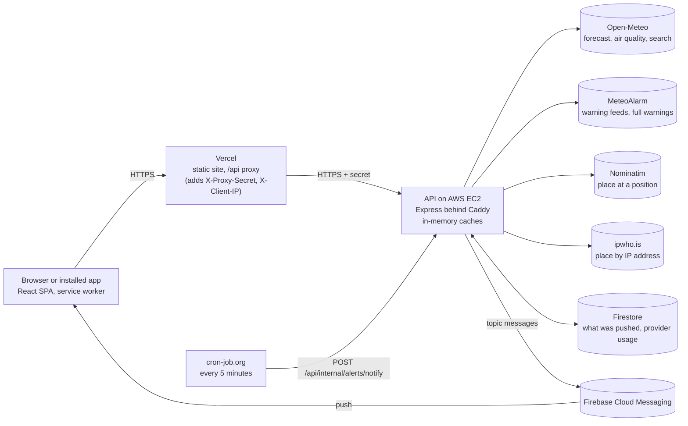
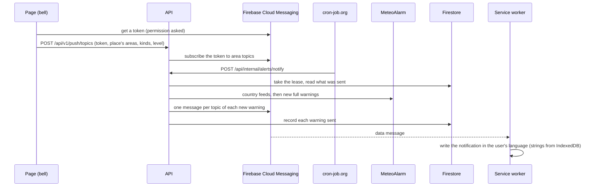

# Architecture

## Overview

A client–server application using the Backend for Frontend (BFF) pattern: the browser talks only to our backend, and
the backend talks to the weather and place providers.

This document describes how each part works: read the section for what you change, not the whole file. The reasons and
the options rejected are in [adr/](adr/README.md); how to set up, test and ship a change is in
[CONTRIBUTING.md](../CONTRIBUTING.md); running it in production is in [operations.md](operations.md).

A warning notification, from subscribing to the device:

## Contents

- **Server:** [Backend layers](#backend-layers) · [Caching](#caching) ·
  [Protecting the provider's limits](#protecting-the-providers-limits) · [Observability](#observability) ·
  [Privacy](#privacy) · [Reliability and security](#reliability-and-security)
- **Client:** [Frontend](#frontend) · [Same-named places in search](#same-named-places-in-search) ·
  [Favourites](#favourites) · [Languages](#languages) · [Temperature units](#temperature-units) ·
  [Header and settings](#header-and-settings) · [Current location](#current-location) · [Detail charts](#detail-charts)
  · [Installable app (PWA)](#installable-app-pwa)
- **Both:** [Push notifications about warnings](#push-notifications-about-warnings) ·
  [Weather warnings](#weather-warnings) · [API versions](#api-versions) · [Testing](#testing) ·
  [Shared package](#shared-package) · [Key parameters](#key-parameters)

## Where to start

| You change…                           | Read                                                                                                                               |
| ------------------------------------- | ---------------------------------------------------------------------------------------------------------------------------------- |
| a provider call, a cache, a limit     | [Caching](#caching), [Protecting the provider's limits](#protecting-the-providers-limits), [ADR 0004](adr/0004-provider-limits.md) |
| an endpoint or a schema in `shared`   | [API versions](#api-versions), [Shared package](#shared-package); then `npm run openapi`                                           |
| the page, a text, a setting           | [Frontend](#frontend), [Languages](#languages) (every text in all 8 locale files), [Header and settings](#header-and-settings)     |
| offline behaviour, the service worker | [Installable app (PWA)](#installable-app-pwa); check in a build (`npm run build && npm run preview -w client`)                     |
| warnings or push notifications        | [Weather warnings](#weather-warnings), [Push notifications](#push-notifications-about-warnings), [operations.md](operations.md)    |
| location, IP lookup, anything stored  | [Current location](#current-location), [Privacy](#privacy) and the `/privacy` page                                                 |
| hosting, secrets, deploys             | [Reliability and security](#reliability-and-security), [deploy-aws.md](deploy-aws.md), [operations.md](operations.md)              |

## Backend layers

- `routes/` validate input (Zod) and map HTTP to service calls.
- `services/` hold the logic: caching, key normalisation.
- `providers/` adapt one external API each to our interfaces (`WeatherProvider` and others).

Dependencies point downward only. Tests replace the providers with fakes. The backend keeps provider keys (if a paid
provider is used) out of the browser, normalises provider data into our own model and caches answers (times in
[Key parameters](#key-parameters)).

Why: [ADR 0001](adr/0001-backend-for-frontend.md)

## Caching

The server caches every provider answer in memory (`TtlCache`, per instance).

**Forecasts** (`/forecast`, `/forecasts`):

- Key: coordinates rounded to 2 decimals (~1 km, `roundCoordinate` and `placeKey` in `shared`, used everywhere a place
  is compared: cache keys, URLs, saved places); the provider is asked for that rounded point, so everyone in the cell
  gets the same answer.
- `days` (1–16) is not in the key: up to 10 the 10-day forecast is loaded and cut, above it the 16-day one, so a place
  has at most two entries.
- Every forecast includes yesterday (`past_days=1`) and the next 24 hours from the current hour (`forecast_hours=24`) in
  the same provider call. Yesterday feeds one line under the current weather ("3° warmer than yesterday", daily highs).
- TTL 15 minutes, so for a few minutes after the hour the first "Now" slot can still be the previous hour.

**Air quality** (`/api/v1/air-quality`):

- A separate Open-Meteo API and host, with its own endpoint and cache: TTL an hour, same ~1 km key and rounded point.
- The server waits up to 10 s for it (5 s for other Open-Meteo calls).
- The client loads it in parallel with the forecast and hides the item if it fails; a failed request retries once after
  20 s, and the page's "Try again" retries both.
- `shared` (`summarizeAirQuality`) picks the index: European AQI for `Europe/` timezones and the Canary Islands,
  Madeira, Azores, Iceland, Faroe Islands and Cyprus, US AQI elsewhere, falling back to the other when a value is
  missing. The API returns both raw values.
- The item shows a dot in the index's official palette (darkest bands lightened for the blue background) and the level
  in words. The value is a button (`aria-expanded`) that reveals PM2.5, PM10, O₃ and NO₂ in µg/m³ without colour; with
  no pollutant data it is plain text.

**`TtlCache`:**

- **Byte budget, LRU.** Size is the JSON size of values (in memory roughly 2–3×): forecasts 16 MB (~8 KB each, ~2,000
  places), searches, places by id and air quality 4 MB each, reverse geocoding 2 MB. The least recently used entry goes
  first.
- **TTL jitter.** Up to 10% of each TTL is taken off at random; jitter never lengthens a TTL.
- **Two stale windows** (as `stale-while-revalidate` and `stale-if-error`):
  - past its TTL an entry is still returned at once while one background load per key refreshes it: 5 more minutes for
    forecasts, 10 for air quality, a day for names;
  - after that a request waits for the provider as on a miss, and gets the old value only if the provider fails:
    forecasts up to an hour old in all, air quality 2 hours, searches and places a week;
  - a stale answer goes out with `max-age=60` instead of 300 or 900 (a batch, if any forecast in it is stale), not
    `no-store`;
  - MeteoAlarm's caches have no stale windows.
- **One load per key** (`TtlCache.getOrLoad`): a load in flight is kept as a promise and requests for the same key join
  it; a failed load is not cached, reaches everyone who waited, and the next request loads again. Used by all caches of
  the weather service, the place lookup and the IP lookup (MeteoAlarm's provider keeps its own promises).
- **In memory only.** A restart starts empty; several instances would each have their own (Redis deferred,
  [ADR 0022](adr/0022-no-redis-while-one-instance.md)).

Metrics per cache: hits, misses, joined loads, stale answers (at once and on errors), failed background refreshes,
evictions, entries and bytes.

**Old-forecast notice.** When a city's current weather is more than 60 minutes old (`forecastAgeMinutes` in `shared`,
checked every minute), a notice above the forecast says "Forecast last updated: 2:00 PM" (with the day if not today:
"yesterday 9:40 PM"). Offline, the offline banner says it instead. Both use one style: a fill darker than the page in
the light theme (white text 7:1), 10% white in the dark theme, and an icon.

Why: [ADR 0003](adr/0003-in-memory-cache.md), [ADR 0023](adr/0023-cache-and-provider-budget-details.md),
[ADR 0012](adr/0012-api-versioning.md)

## Protecting the provider's limits

Open-Meteo's free tier (600 calls a minute, 5,000 an hour, 10,000 a day, per server IP) is the bottleneck. Layers, in
order of effect:

1. **Caching and coalescing** (above).
2. **Batch forecasts** — `GET /api/v1/forecasts?places=…`, up to 10 (`MAX_FAVORITES`):
   - each place goes through the same cache as `/forecast`; each item is a forecast or an error; a partial answer is
     `no-store`, an answer with nothing is the usual error;
   - the client (`api/forecastBatch.ts`, `useForecast(…, { batch: true })`) batches saved cities' tiles and cards asked
     for in the same render;
   - the city page's own forecast always goes alone to `/forecast` (`sendAlone` takes it out of a queued batch); a place
     left alone in a batch also uses `/forecast`;
   - the client falls back to one request per place when the server has no batch endpoint or the network fails;
   - the service worker splits each stored batch into per-city copies under the URLs the city pages ask for
     (`src/sw/splitForecastBatch.ts`, a Workbox `cacheDidUpdate`), and deletes copies older than a day whenever a batch
     is stored; a `cacheWillUpdate` plugin skips `no-store` answers.
3. **Rate limits per IP** (`express-rate-limit`, `rateLimits.ts`), one-minute window:
   - 300 for the API, 60 for search, 10 for `/places/*`, 30 batches for `/api/v1/forecasts`;
   - `/api/health` and `/api/internal/*` are not limited;
   - over the limit: `429 RATE_LIMITED` (translated, "Try again" offered) with `RateLimit` and `Retry-After` headers;
   - counts are in memory, per instance.
4. **Client address** (`req.ip`): the Vercel middleware (`client/middleware.ts`) rewrites `/api/*` to the API, adding
   `X-Proxy-Secret` (`PROXY_SECRET` on both sides) and `X-Client-IP` (the address Vercel saw):
   - with `PROXY_SECRET` set, the API answers 404 to requests without the secret and takes `X-Client-IP` as `req.ip`
     only together with it; health and `/internal/*` stay open (`/internal/*` has its own secret);
   - otherwise only the proxies in `TRUST_PROXY` are trusted for `X-Forwarded-For`;
   - without the variable (local development, tests) every request is served;
   - a direct call to the API host (`https://<ip>.sslip.io`) gets 404;
   - `express-rate-limit` logs a warning when the proxy setup looks wrong.
5. **Provider calls per address** (`LoadLimiter`, `rateLimits.ts`): forecast and air-quality calls one address causes,
   30 a minute and 150 an hour:
   - only provider calls count; a cached answer is never refused; a refused refresh of a stale entry still sends the
     stale value;
   - over it: `429 RATE_LIMITED`, per place inside a batch;
   - IPv6 counts per /56; past 50,000 addresses in a window new ones are not counted;
   - two requests for the same new place at once share one load, and so one refusal.
6. **Empty coordinates** (`?lat=&lon=`, `places=,`) get 400. Every 400 names the parameter: `lat: Required.`,
   `lat: Must be a number.`, `lat: Too big: …`.
7. **Budget for the whole server** (`Metrics.budget`), in Open-Meteo's units (`openMeteoWeight`: variables / 10 × days /
   14):
   - our forecast is 22 variables over 11 days, 2.2 calls; air quality and search 1; a place kept fresh all day costs
     ~235 calls, so the budget covers ~38 such places;
   - before each Open-Meteo call (forecast, search, places by id, air quality) usage in the last minute, hour and day is
     checked; at 90% of any limit (`BUDGET_SHARE`) new calls are refused until the window moves on;
   - while refused, cached and stale-if-error answers still go out; anything else gets `503 SERVICE_BUSY` (translated,
     "Try again" offered);
   - ipwho.is has a cap of our own: 30 a minute, 1,000 a day; its answers are cached a day per address;
   - Nominatim has no budget: its queue allows one call a second for the whole server;
   - a refusal is logged at most once a minute and counted (`refused` in the metrics).

Why: [ADR 0004](adr/0004-provider-limits.md), [ADR 0005](adr/0005-hosting-same-origin-proxy.md),
[ADR 0023](adr/0023-cache-and-provider-budget-details.md)

## Observability

- **Logs:** JSON lines (pino) on stdout, kept by journald on the VM.
  - One line per request: method, path without the query, status, duration; no query, no IP.
  - Provider errors with their cause (timeout, HTTP status); unhandled errors with the stack.
  - `LOG_LEVEL=debug` adds every provider call (provider, host, path, status, duration).
  - `npm run dev` pipes them through pino-pretty. The health check is not logged.
- **Metrics** (`observability/metrics.ts`):
  - per cache: hits, misses, coalesced requests, hit rate; per provider: calls in the last minute, hour and day against
    its limits, with errors; responses by status class; rate-limited requests;
  - provider calls are counted by wrapping the `fetch` each adapter takes;
  - at 80% of a limit a warning is logged once per window, and `GET /api/health/quota` (public) answers 503 with the
    provider, window and share ([operations.md](operations.md));
  - read at `GET /api/internal/metrics` (bearer `METRICS_SECRET`; without it the endpoint does not exist) and every 15
    minutes as a `metrics` log line;
  - in memory, lost on restart, except provider usage, saved to the state store once a minute and restored at start
    ([ADR 0018](adr/0018-durable-operational-state.md)).
- **Health:** `GET /api/health` (uptime monitor, `deploy.sh`) returns uptime and the commit (`GIT_COMMIT`, written by
  the deploy script). It does not call the provider. With `PROXY_SECRET` set it reports whether the request carried the
  right secret (`proxied`).

Why: [ADR 0024](adr/0024-server-hardening-observability-privacy.md)

## Privacy

The policy is the page `/privacy` (`client/src/pages/PrivacyPage.tsx`, linked from the footer, loaded on demand), in
English only. It describes what the code does: a new service that receives anything from the user, or new data kept,
means editing it. As built:

- no accounts, cookies, analytics or ads; favourites and settings stay in the browser, and so do the last loaded
  forecasts, air quality and place names (the service worker's cache, up to 50 for a day; the policy lists it), and,
  after a tapped notification, the page it opens (IndexedDB `open`, removed when used or after two minutes);
- the server sees places and searches and passes them to Open-Meteo and Nominatim as itself; it sees the IP address for
  rate limiting (memory, a minute; not in logs) and browser error reports (message, stack, page kind, user agent);
  places, searches and error reports reach the logs, which journald on the VM keeps 14 days (`MaxRetentionSec`, set by
  `deploy/vm/setup.sh`);
- the IP goes to ipwho.is only when the locate button was pressed and the browser found no position; the result is
  cached a day in memory under a keyed hash of the address (`ipFingerprint`, a random key per process);
- with notifications on, the browser talks to Firebase and its push service; the server subscribes the device's token to
  topics named after warning areas without storing it (a SHA-256 of the token is kept in memory for an hour to limit
  changes per device);
- the server's operational state in Firestore ([ADR 0018](adr/0018-durable-operational-state.md)) holds nothing about
  users: warning identifiers, times and provider call counts;
- the font is part of the build (`@fontsource-variable/bricolage-grotesque`); the Content-Security-Policy lists no
  Google hosts except Firebase's; the service worker deletes its old Google Fonts caches; an end-to-end test checks that
  font files come only from the site.

Why: [ADR 0017](adr/0017-privacy-policy-and-own-font.md),
[ADR 0024](adr/0024-server-hardening-observability-privacy.md)

## Reliability and security

- **Configuration fails closed** (`server/src/config.ts`): every setting is read and checked before the server starts.
  - In production (`NODE_ENV=production`, set by the systemd unit, or `RENDER=true`) the server refuses to start without
    `PROXY_SECRET` (at least 32 characters) or `TRUST_PROXY`, with `IP_SELF_LOOKUP=1`, with Firebase but no
    `ALERTS_NOTIFY_SECRET`, with a short `METRICS_SECRET`, or with a non-https or local `CORS_ORIGIN`.
  - All problems are listed at once, never a secret's value. Locally every setting is optional.
  - The Vercel middleware refuses an `API_ORIGIN` that is not a bare `https://` origin (http only for localhost) and, in
    Vercel's production environment, a missing `PROXY_SECRET`.
- **Outbound requests** (`providers/meteoAlarm.ts`): full warnings (CAP) are fetched only over https from
  `feeds.meteoalarm.org`, default port, no credentials in the URL, no redirects (`redirect: 'error'`); an entry linking
  elsewhere is dropped. The VM's firewall does not restrict outgoing traffic.
- **Provider answers are bounded and checked** (`providers/http.ts`):
  - bodies are read as a stream and abandoned past 2 MB (JSON), 8 MB (feed) or 1 MB (CAP); a larger `Content-Length` is
    refused before reading (live answers are ~30 KB, up to ~640 KB and ~20 KB);
  - Open-Meteo's parallel arrays must have the same length (at least one entry), and the adapter's result is parsed with
    `shared`'s schemas (`forecastSchema`, `airQualitySchema`, `locationSchema`) before caching; any failure is a
    `ProviderError`;
  - Nominatim and ipwho.is answers are type-checked field by field;
  - MeteoAlarm feeds are cut at 5,000 entries, 50 polygons an entry, 5,000 points a polygon (live: ~420 entries in
    Germany's feed, polygons under 400 points); fetches go through three queues (`concurrencyLimit`): the ~40 feeds in
    one, the pages' CAP documents 10 at a time in another, the notifier's 5 at a time in a third, so a run after
    downtime cannot make a visitor's warning wait.
- **Notification changes are limited** (`routes/push.ts`, `POST /api/v1/push/topics`, one Firebase Admin call per
  area):
  - 60 a minute per IP (`rateLimits.push`), on top of the general limit;
  - 120 an hour per token, keyed by its SHA-256; the client re-subscribes places one by one;
  - a global budget (`FCM_TOPIC_LIMITS`): 300 calls a minute, 20,000 a day, refusing at 90% with `503 SERVICE_BUSY`,
    shown by `/api/health/quota`;
  - at most 4 Firebase calls at once, the budget checked again when a queued change's turn comes;
  - the same change already under way is joined;
  - turning notifications off is exempt from the per-token allowance and the budget (still counted, still under the
    per-IP limit).
- **Operational state** ([ADR 0018](adr/0018-durable-operational-state.md)): what the notifier has sent, a lease for one
  notifier run at a time, and provider usage are kept in Firestore when Firebase is configured, in memory otherwise.
  Provider usage is added back at start (before anything is saved), then saved once a minute and at shutdown, awaited
  before exit. Forecast caches stay in memory ([ADR 0003](adr/0003-in-memory-cache.md)); per-IP limits are per
  instance.
- **Shutdown** (`shutdown.ts`): on SIGTERM (systemd kills 30 s later) the server stops accepting connections,
  `/api/health` answers 503, every answer closes its connection, requests under way get up to 10 s, idle keep-alive
  connections are closed, and the rest is cut. An uncaught exception or unhandled rejection is logged (`fatal`, with the
  stack) before exit; systemd restarts the process.
- **Errors in browsers** ([ADR 0014](adr/0014-client-error-reporting.md)):
  - an `ErrorBoundary` around the page content shows "Something went wrong" with a reload button while the header keeps
    working; the next page renders again; an outer one shows a plain English message;
  - render errors (`createRoot`'s `onCaughtError` / `onUncaughtError`) and uncaught errors and rejections go to
    `POST /api/v1/client-errors`, logged as warnings (`client error`, with the stack, component stack, browser, build);
  - the client sends the path with places replaced by a placeholder, no query, nothing from storage; each error once,
    five per page at most; browser and extension noise ignored;
  - the endpoint validates and bounds the report, ten a minute per address.
- **Security headers:** the site's are in `client/vercel.json`, and `vite preview` sends the same (read from that file).
  - CSP: only our own scripts, styles and fonts, our API and the two Firebase hosts push needs
    (`firebaseinstallations`, `fcmregistrations`); no framing. Also HSTS, `nosniff`, `Referrer-Policy`, and a
    `Permissions-Policy` allowing geolocation to the site only.
  - End-to-end tests fail on any console error, so a policy violation fails them; one test checks the headers and that
    an injected script and an inline style are blocked. React's inline styles are set through the DOM, which the policy
    allows; axe's own are not counted.
  - Push is not exercised under the policy in tests: check turning notifications on and off after deploying.
  - The API's answers get helmet's headers.

Why: [ADR 0024](adr/0024-server-hardening-observability-privacy.md), [ADR 0014](adr/0014-client-error-reporting.md),
[ADR 0018](adr/0018-durable-operational-state.md)

## Frontend

SPA with client-side routing (React Router):

- `/` — start page
- `/weather/756135-warsaw` — forecast for a city from search: its id and a readable slug
- `/weather/:lat,:lon?name=&country=` — forecast for a place without a city id (a position found by location)
- anything else — not found

**Links** ([ADR 0006](adr/0006-place-urls-by-id.md); code: `locationUrl.ts` with `placePath`, `parsePlaceRoute`,
`slugify`; `placeRoute.ts` with `resolveRoute`, a plain tested function; `hooks/usePlaceRoute.ts`):

- A city is identified by its GeoNames id (Open-Meteo's location id); the slug after it is for people only.
- The slug is plain Latin from the English name. Cyrillic and Greek are transliterated (`756135-varshava`); other
  scripts give no slug.
- The name and country on screen come from a lookup by id in the reader's language.
- Whatever follows the id is not checked: a link with another slug (another language, or edited by hand, such as
  `756135-Warsaw`) opens by the id, and once the English name is known the page replaces the address with the
  canonical one (`history.replace`, no extra back step).
- A saved city opens at once, with coordinates from the favourites. Another city waits for one lookup by id (cached a
  day, and by the service worker for offline), showing the page skeleton meanwhile. An unknown id is "not found".
- The coordinates come from any lookup of the id that has succeeded, in any language: switching the language keeps the
  forecast while the new lookup runs (or fails offline). Loading or an error shows only when nothing about the id is
  known yet.
- Lookups by id share one cache with the place names: one request per id and language.
- A place without an id keeps coordinates in the path and the name in the query.
- Older links (`/weather/52.23,21.01?name=…&id=…`) still open and move to the id form once the id is confirmed to be at
  those coordinates; an edited one keeps its coordinates.

**Code layout and styles:**

- Pages live in `pages/`, reusable UI in `components/`. A large component keeps its pieces in a folder of its own
  (`components/settings/`: the language list, the warnings list and its rows).
- Styles are plain global CSS with BEM-like class names, one file per part of the page in `client/src/styles/`,
  imported in a fixed order by `styles/index.css`. The order is the cascade: later files win at equal specificity.
- Each style file ends with its own reduced-motion overrides.
- Weather icons are a small hand-drawn set of filled two-colour SVGs (`WeatherIcon.tsx`). `shared` only names the
  icon kind.
- On each navigation the app sets `document.title` and moves focus to the place heading.

**Data loading:**

- Data fetching lives in hooks: `useLocationSearch`, `useForecast`, `useAirQuality`.
- Every API request has a 15-second limit, answer included (`REQUEST_TIMEOUT_MS` in `shared`); past it the request
  fails as `NETWORK_ERROR` with "Try again". With a saved copy, the service worker shows it after 6 seconds. The timer
  is built by hand, not with `AbortSignal.timeout`/`any`.
- Forecasts and air quality go through a shared in-memory cache (`api/queryCache.ts`, TTL equal to the API's
  `Cache-Control` max-age, 5 and 15 minutes): a place already loaded (for example by its favourite tile) renders at
  once, concurrent requests for one place are merged, errors are not cached.
- An unknown place shows a placeholder shaped like the page; the air quality slot is kept while it loads;
  `scrollbar-gutter: stable` keeps the content width fixed.
- `useRevalidateOnReturn` loads forecasts and air quality again when the page comes back into view (another tab, an
  app switched back to, a phone woken up) or the connection returns while it is in view, if the shown data is at least
  as old as the server keeps it: 15 minutes for forecasts, an hour for air quality. Every place on the page does it;
  favourite tiles go in one batch.
- Meanwhile the old data stays on screen with no loading state, and stays if the new load fails (the outdated notice
  then says how old it is).
- Nothing is reloaded on a timer while the page stays in view, except warnings.

**City page:**

- Header buttons by the name: the star (favourites, icon only), then the bell (warnings). Their tooltips are CSS from
  `data-tip`, shown on hover and keyboard focus. On phones the country goes under the name, so the name and the
  buttons share a line.
- Wording is "favourites" everywhere: the star's tooltip is "Add to favourites" or, when saved, "In favourites"; its
  hidden name is "Add to favourites" or "Remove from favourites"; the full-list hint is "You can add up to 10 cities to
  favourites".
- "You are here" is plain text after the country, on its baseline, in the same colour and 0.85em ("Poland · 📍 You
  are here"). "Approximate, by IP" has a yellow pin and its own words. On a phone the mark moves under the district
  and region line. It is drawn twice: visually hidden in the heading (read with the name), and an `aria-hidden` copy
  below.
- A name longer than the screen (one word, such as Llanfairpwllgwyngyll…) breaks inside the word; the buttons stay on
  its first line.
- The current temperature has a weather icon after the number, centred on it and sized from its font (0.62em),
  decorative (`aria-hidden`); the condition is written on the next line.
- Several warnings collapse to the most severe and soonest one plus "3 more warnings".
- The hourly strip shows the chance of rain under the icon in hours above 30%, in one fixed-height slot shared with the
  icon; in a dry hour the icon sits in the slot's middle. Sunrise and sunset are cells of their own between the hours.
- The 10-day list's day column is as wide as the longest day name in the list (rows are subgrids of the list,
  `max-content`), leaving 12 px before the icon. Browsers without subgrid keep a fixed 3.5rem column.
- Today's row in the 10-day list is lighter (a pseudo-element, so the subgrid's columns do not shift), with a
  decorative dot on its bar for the temperature now; the bar, and so the dot, is hidden on phones.

Why: [ADR 0025](adr/0025-frontend-search-and-favourites-details.md)

## Push notifications about warnings

Free services only: the server keeps no subscriptions ([ADR 0011](adr/0011-push-via-fcm-topics.md)); what was sent is
kept in a `StateStore` ([ADR 0018](adr/0018-durable-operational-state.md)).

**Subscribing:**

- Subscriptions are Firebase Cloud Messaging topics, one per area, kind and minimum level (`PL1261.storm.orange`).
- A device subscribes its push token through `POST /api/v1/push/topics`. The server computes the areas of the place
  (its MeteoAlarm regions, as for the page, or a 0.25° grid cell where countries draw their warnings) and asks FCM.
  Nothing is stored on the server.
- The device keeps its own list in `localStorage`, to change or undo it, renew it when its token changes, and name the
  place in a notification.
- Unsubscribing a token FCM no longer knows succeeds (it is on no topic).
- The client joins the new topic before leaving the old one. If leaving fails, the old topic is remembered in storage
  (`leave`) and retried on the next change, on turning off and on the next start.
- Every change to the stored subscriptions (on, off, a new setting, a new token, leaving old topics, retries) runs one
  at a time in one queue. A pending leave of the setting that is current again is dropped, never sent.
- A new token: every stored place moves to it before another place is subscribed.

**The scheduled run** (`POST /api/internal/alerts/notify`, called every 5 minutes by cron-job.org):

- The run takes a lease (4 minutes), so overlapping instances during a deploy do not both push. It renews the lease
  before each send once half of it has passed, and stops if it was lost.
- It reads the saved state at the start of every run and merges it into memory (not replaces). A failed read fails the
  run; an unreadable document is ignored with a warning.
- It saves the state after each warning sent and after every run, failed ones included.
- Shutdown waits for a run under way (at most 5 seconds); a run cut anyway has already recorded what it sent.
- It reads all ~39 country feeds (cached 4 minutes) and loads the full text only of warnings not seen yet, all at once
  (the provider fetches ten at a time). Overlapping runs share one.
- The broadcast path parses each full warning with its feed entry as fallback and shares the page's cache, so both read
  one version.
- With saved state, warnings issued while the server was down are pushed on the next run.
- Warm-up: without saved state (the first start, or the memory store), the first read of each source (a country's
  feed) only records the warnings in force. Warm-up is per source: a feed that failed on the first run, or a warning
  whose full text failed then, is recorded silently when first read.
- A run in which every feed failed answers 502; a run with some feeds failed answers 200 with `feedsFailed`.

**Sending:**

- A new warning is published to every topic it reaches: each area × (storm, all) × each minimum level up to its own.
- One notification per warning: a CAP update names the warning it replaces (`references`) and keeps the first
  version's key, which is the notification's `tag`. An update is pushed again only if its level went up.
- A device in two areas gets the same warning at most twice; the same tag replaces it quietly (`renotify: false`).
- Warnings are sent one at a time. A warning counts as sent only once FCM accepted its messages: `sendEach` reports
  rejections per message, and every rejection except a known permanent one (such as a malformed message) becomes an
  error. Network errors arrive there as `app/network-error`. A failure retries just that warning on the next run and
  fails the run.
- Permanent rejections are not retried. They are counted (`rejected` in the run's answer and in the status), logged as
  errors and keep the run from counting as a success; their time (`lastRejectedAt`, saved with the state) keeps
  `/api/health/notify` at 503 for 30 minutes.
- The data payload stays under FCM's 4 KB: `fitPayload` caps it at 3,800 bytes counted in UTF-8, dropping headlines
  first, then the area list, then languages other than English and the issuer's first. Headlines are also capped at
  160 characters.

**Monitoring:** `GET /api/health/notify` (public: feed codes and times only) answers 503 when no run has fully
succeeded (every feed read, nothing refused) for 30 minutes, or FCM refused messages within them.

**The device** (`public/push-sw.js`, loaded into the generated service worker):

- Messages are data-only: level, type, times, areas, the issuer's texts.
- The service worker writes the notification in the user's language, reading from IndexedDB the user's places and the
  strings the page stored for the current language.
- Title "Orange warning: Thunderstorms · Kraków"; body the time and the issuer's headline. A tap opens the city page:
  with no window of the app open, a new one; with one open, the worker focuses it and asks its page to open the city
  (`open-place` message, `useOpenFromNotification`, the app's router, no reload), and navigates the window itself
  (`WindowClient.navigate`) only when the page does not confirm within a second, a new window as the last resort. Focusing runs alongside, and every step has a 3 s limit (`within`), so the click event always ends. Alongside, the worker records the page to open (`recordOpen`, IndexedDB `open`, with the time; waited for at most 500 ms, and only before messaging the page, so focus() and openWindow() start at once), and the app opens a record under two minutes old when it loads or shows again, checking once more a second later, and removes it (`takePendingOpen`); the message route removes it too. A page already at the place does not navigate again (no second history entry). Each route taken is logged to the worker's console (`notification click: …`), for Safari's Web Inspector.
- **iPhone, app running:** iOS does not dispatch `notificationclick` then, so a tap only brings the app forward on the
  page it showed; a closed app is launched and opens the city.
- Every push shows a notification. If writing the full one throws (stored state of an older format, IndexedDB
  unavailable, an invalid locale), a plainer one with the same tag is shown from the message alone (the issuer's event
  and headline in the browser's language, else "Weather warning"), and the error goes to the worker's console.
- Reading IndexedDB never rejects nor hangs: unreadable means no saved state.
- The page and the worker close their IndexedDB connection once done.

**The bell** (next to the star; all places with notifications on are also listed in the settings, see "Warnings in the
settings"):

- Its panel has a switch, storms or all, and the minimum level. Defaults: storms, from orange.
- Permission is asked only when the switch is turned on.
- A choice shows at once. With notifications on, applying it takes a second or two (token, leaving and joining topics);
  until the server answers, the options and the switch are `disabled` (the others dimmed), the control that started
  the change shows a spinner (next to the switch, if it was the switch), and the panel is `aria-busy`.
- When the lock ends, focus goes back to the control last used in the panel. `latestOnly` runs changes one at a time.
- After a failure the panel shows the stored settings again.
- On an iPhone in the browser the panel explains installing first (web push works only from the Home Screen app, iOS
  16.4+); when notifications are blocked, it says where to allow them.
- There is no bell without Firebase config (the default), nor where MeteoAlarm issues no warnings: `/api/v1/alerts`
  returns `covered` (a region of the borders file, or a box of a country that draws its areas; Minsk and New York are
  not covered).
- The bell appears once coverage is known. A place subscribed earlier keeps it, to be turned off.
- In `npm run dev` the panel says up front that there is no service worker there (only the build has one).
- The Firebase SDK loads only on demand (a separate ~19 KB gzip chunk), never in the main bundle.

**Status and tests:** verified end to end on 2026-11-01 on a desktop (Chrome, Safari, Firefox), Android in Chrome and
an iPhone Home Screen app, with test pushes (`npm run push:test -w server`, README) and the scheduler running; not yet
with a real warning. The server logic (repeats, updates, warm-up, topics), the store and the service worker's rendering
are unit-tested.

**Native apps:** none for now ([ADR 0021](adr/0021-no-native-apps-yet.md)). They would use the same topics, with
`apns`/`android` fields and localization keys added by the server.

Why: [ADR 0026](adr/0026-push-delivery-details.md)

## Same-named places in search

**In search suggestions:**

- Search also matches places by old or other names ("Kiev" finds Kyiv; "rhodes" finds Esmond, North Dakota).
- The server maps GeoNames feature codes (`ISL…`, `ATOL`) to `kind: 'island'` on `Location`, an optional field open to
  more kinds; clients ignore kinds they do not know.
- The suggestion reads "Rhodes · island"; so do the tab title and a notification. The page heading and favourite tiles
  and cards put the word on the country line ("island · Greece").
- `areas` carries GeoNames admin2–admin4 (province, district, municipality; '' where a level is missing, so positions
  line up).
- Suggestions that would read exactly the same (same name, kind, region and country) get the first level at which they
  differ (`describePlaces`): two villages "Rode" become "Geetbets, Flanders, Belgium" and "Glabbeek, Flanders,
  Belgium". Real duplicates (no level differs) stay as they are.
- An older cached `/api/v1/locations/:id` answer (browser `max-age` one day) shows no island mark until it expires.

**On the page:**

- The lookup by id the page makes also returns the region and the levels below it. The page shows the district and
  region on a line below the name and buttons ("Powiat otwocki · Masovian Voivodeship").
- Each part stays whole, so a long line wraps at the dot ("Powiat warszawski zachodni ·" / "Masovian Voivodeship").
- The district is left out when it is the city itself (it repeats the name, the region or the level below), compared
  without diacritics and up to two letters apart for names of five or more letters; otherwise it is shown, even
  untranslated.
- The region is left out when it repeats the name (Berlin, Tokyo, Kyiv) or has no translation: in an interface not
  written in Latin letters a Latin region is dropped. In Latin-script interfaces an English fallback stays.

**In favourites:**

- Favourite tiles and cards add, only for places whose name, kind and country are shared, the first level at which they
  differ, with words common to the group dropped at the start and end ("Województwo mazowieckie / lubelskie" →
  "mazowieckie / lubelskie").
- Namesakes are matched in any form of the name: the interface language, English (the same lookup by id, in English,
  cached a day) or as saved.
- Places saved without an id get their levels from a name search in the interface language, with no English alias.
- Only places whose levels are known are compared, narrowing level by level to the places sharing a value: with three
  Józefów, two in Masovia, the Lublin one gets its voivodeship and the Masovian ones their districts.

Why: [ADR 0025](adr/0025-frontend-search-and-favourites-details.md)

## Favourites

Saved cities live in the browser (`localStorage`, key `favorites:v1`), with no accounts and no server state
([ADR 0007](adr/0007-favourites-in-browser.md)).

- **Rules in `shared`** (`favorites.ts`): a favourite is coordinates plus display name and country. Places are matched
  by coordinates rounded to ~1 km, like place URLs, so a city is never saved twice. New ones go to the top; the list is
  capped at 10. `parseFavorites` validates what comes out of storage.
- **Full list:** saving is blocked, nothing is dropped. The star keeps its look; pressing it opens a two-line message
  under the buttons ("You can add up to 10 cities to favourites" / "Remove one to add this city.") in a live region,
  closed by Escape or a click elsewhere.
- **Client:** `favoritesStore.ts` holds the storage work as plain functions (reading, the subscription, `save` /
  `remove`), unit-tested with a stubbed `localStorage`. `useFavorites` connects it to React through
  `useSyncExternalStore`; the `storage` event keeps every open tab in sync.
- **Star button** by the city name, icon only: the star fills in when saved; its hidden name says what pressing does,
  so it has no `aria-pressed`.
- **Start page:** the greeting (heading and a line on what to search for), then saved cities as a grid of cards (name,
  country, icon, current temperature, condition, today's high/low); four columns on desktop, two on phones, fixed
  height so cards do not grow when weather arrives. The greeting starts 12vh below the search; on screens up to 480 px
  it follows the search with the page's usual spacing.
- **City page:** saved cities form a scrolling strip of compact tiles (city, country, icon, temperature) between the
  search and the weather, the same on every screen size. The open city stays in the strip, highlighted with
  `aria-current="page"`. The strip shows during loading and errors too.
- **Requests:** tiles and cards load their forecasts in one batch request (`/api/v1/forecasts`,
  `api/forecastBatch.ts`) and share the forecast cache with the city page, so opening a saved city is instant.
- **Order** is newest saved first. A value left in `home-city:v1` from the removed home city is ignored.
- **Path to accounts:** keep the hook's API and swap its source for a server; on first sign-in, merge the local list
  into the account. The server would need a `favorite_locations` table, a session cookie, owner checks on every request
  (IDOR) and `Cache-Control: private, no-store` on personal responses.

Why: [ADR 0025](adr/0025-frontend-search-and-favourites-details.md)

## Languages

8 languages: en, de, fr, es, it, pl, uk, ru ([ADR 0016](adr/0016-fewer-languages.md)). Right-to-left support stays in the code (for Arabic and Hebrew).

- **Default:** the first of `navigator.languages` the app supports, matched by base language (`de-AT` → German), else English. A choice in the switcher is saved in `localStorage` and wins next time.
- **Translations:** `client/src/i18n/locales/`, one typed file per language, about 2 KB gzip each, all bundled. The `Messages` type makes a missing key a compile error. No i18n library: plurals use `Intl.PluralRules`, the rest are plain functions.
- **Numbers and dates** (weekdays, 12/24-hour time, percent, wind units) come from `Intl`, not from translated strings.
- **The API is language-neutral:** it returns condition keys (`partly-cloudy`) and error codes; the client translates them. Only place search takes `lang` (Open-Meteo returns names in it); `lang` is part of the search cache key.
- **One digit system per screen:** every number, including temperatures and `{n}` in plurals, goes through `Intl.NumberFormat` for the full locale. Language files are functions of the formatters (`MessagesFactory`): `ar-EG` shows `١٤°`, `ar` shows `14°`. In right-to-left languages a temperature is wrapped in a bidi isolate (U+2066…U+2069).
- **Right-to-left:** `<html dir>` follows the language (`isRtl`); CSS uses logical alignment (`text-align: end`); each day's low, bar and high stay one left-to-right block.
- **Place names follow the UI language:**
  - Places from search carry the provider id (`?id=` in the URL, `id` in a favourite). `useLocalizedPlace` fetches names in the current language from `GET /api/v1/locations/:id?lang=` (Open-Meteo `/v1/get`), cached for a day on the server and in the client.
  - Favourites without an id fall back to a search by the stored name, keeping only a result at the same coordinates.
  - The stored name (from the search language, in favourites and `?name=`) is shown while loading or if the lookup fails.
  - The id from the URL is untrusted: a name is used only if the place found is at the same coordinates. "Save" keeps the id only once confirmed (`withVerifiedId`); otherwise the city is saved without it and found by name.
  - Save and remove stay enabled during the check: a click waits for it (same request as the page), and clicks run in order. The hook's actions are `save` and `remove`, not a toggle; a waiting save that finds the city already saved does nothing.
  - Provider ids are positive 32-bit integers (`isValidLocationId`); larger ones are dropped by the server schema (400, no provider call), `parsePlace` and `parseFavorites`.
- **Names in another script:** a place's name and country on favourite tiles and cards have `dir="auto"`, so a Latin name in a right-to-left UI is cut at its own end. Alignment and room for the warning mark follow the page via `[dir='rtl']` rules.

Why: [ADR 0008](adr/0008-languages-and-units.md), [ADR 0027](adr/0027-languages-units-and-charts-details.md)

## Temperature units

- **Default:** `defaultTemperatureUnit` (shared) gives °F only when the region of the first system locale is the US, Bahamas, Belize, Cayman Islands, Palau, Liberia, Marshall Islands or Micronesia _and_ the device's time zone is one of theirs (`America/Chicago`, `Pacific/Honolulu`, `America/Nassau`…); °C otherwise, and when either is missing (`en` without a region). The choice in the settings is saved in `localStorage` (`temperature-unit`) and wins.
- **Converted on the client:** the API and both caches are in °C. `useUnits().temp(celsius)` converts, then rounds to the whole number shown; `deg` only formats. The day-over-day comparison compares converted values. Range bars are unchanged (linear conversion).
- **Display:** "14°" without a unit letter; screen readers say "14 degrees"; the unit is in the settings. Wind has its own unit, independent of temperature.
  Why: [ADR 0008](adr/0008-languages-and-units.md), [ADR 0027](adr/0027-languages-units-and-charts-details.md)

## Header and settings

- **Way home:** a line above the search holds the logo: the app icon on a small blue tile (`#1d4f86` light, `#3468a0` dark) and the short name "Weather" (the tab title stays "Weather forecast"). It links to the start page, has no frame, and is `aria-current="page"` on the start page. It takes about 46 px on a phone. The start page is the entry point and the overview of saved cities (cards with condition, high and low, warnings).
- **Settings behind a gear** next to the search field (name in hidden text):
  - a disclosure (`aria-expanded`), not an ARIA menu; Tab moves through it;
  - °C/°F is a two-button switch (`aria-pressed`); the language row opens the list inside the panel, with a back button; rows with an arrow are where more units (wind, pressure) would go;
  - Escape steps back (list → panel → closed); a click outside or Tab past the end closes it; focus returns to the gear or the language row;
  - pop-up panels (settings, search suggestions) are pale blue `#e8eff7` in the light theme; soft text on it is 4.7:1; highlighted rows are one step darker.
- **Warnings row in the settings** ("2 cities" / "Off", counting places with notifications on); the bell by a city name stays:
  - saved cities first (★, favourites' order, always listed; turning on uses the default "storms from orange"), then other places with notifications on;
  - each row: the place's settings ("Storms · From level: Orange" or "Off") and a switch (`role="switch"`); the name links to the city page, where the bell sets which warnings come;
  - two lines above the list say which cities it shows and how to set a city's warnings;
  - an unsaved place switched off stays (switch off) until the menu closes, with a line naming it ("Kraków will leave the list when you close the menu");
  - places turned on in another tab join at the end; one change at a time (`aria-disabled`, not `disabled`, so focus stays);
  - no saved city and nothing on: a line on where to turn notifications on; no row at all without Firebase config or Push API;
  - switches appear only when notifications are available (otherwise the bell's explanation) and the place is `covered` by MeteoAlarm (same cached `/api/v1/alerts` answer); otherwise "No data from MeteoAlarm", plus, only if the list has such a place, a line that warnings cover MeteoAlarm countries only; a place already on can always be turned off;
  - turning on passes the place's time zone, read from the shared forecast cache after the permission prompt;
  - saved cities are named in the interface language; the Russian hint uses the polite "you".
- **Language list:** our own listbox (`aria-activedescendant`, arrows, Home/End, Enter/Space, Escape goes back), not a native `<select>`. It scrolls within a max height (the list, not the page), and typed letters jump to an option ("po" → Polski, "p" again → next on "p"). Each name is in its own language with `lang`.

Why: [ADR 0027](adr/0027-languages-units-and-charts-details.md)

## Current location

- **Coordinates from the browser** (Geolocation API), only from the crosshair in the search field: `enableHighAccuracy: false`, 10 s timeout, a position up to 10 minutes old is reused, one request (no watching or retries). Coordinates are rounded to ~1 km at once, so the exact position never reaches the URL, the server or logs.
- **Name (reverse geocoding):** `GET /api/v1/places/reverse` asks OpenStreetMap Nominatim behind a `ReverseGeocoder` interface (separate from `WeatherProvider`), with `accept-language`.
  - The adapter spaces requests to 1 per second and refuses at once one that would wait over 3 s; it sends an identifying `User-Agent`; the footer shows "© OpenStreetMap".
  - Cache: 7 days by rounded coordinates and language, including "no place here" (e.g. the sea).
  - The client waits up to 4 s, then opens the forecast for the position without a name (the page shows coordinates).
- **The position becomes the city:** `PlaceService` looks the Nominatim name up in the cached Open-Meteo search and takes the nearest result within 25 km, returning its coordinates and id, as search does. No match: the position itself, without an id. Search failed: the position, not cached on the server and sent `no-store`. The client caches only final answers (a city with an id, or "no place here").
- **A saved city wins (`findSavedCity`, client):** before opening, same coordinates, same id, or the same name within 25 km opens the saved entry. No request.
- **Responses are checked (`toFoundPlace`):** an answer without valid coordinates opens the position.
- **A late answer is dropped:** picking a city in search, typing, or opening another page cancels the lookup.
- **When the browser can't locate:** the message offers "Try again" and the city guessed from the IP address (offered, not opened). Not offered after a refusal.
  - `GET /api/v1/places/approximate` asks ipwho.is (HTTPS, no key) behind an `IpLocator` interface, cached per IP for a day, then turns the position into the city through `PlaceService`. Sent as `private, no-store`.
  - The IP is `req.ip` with Express `trust proxy` = number of proxies in front (`TRUST_PROXY`, 1 behind Caddy on the VM; required in production).
  - A private address: the server's own public address is looked up only with `IP_SELF_LOOKUP=1` (local `.env` only; refused in production); otherwise 404.
  - ipwho.is reports quota and rate limits in the body (`success: false`): only "can't place this address" is cached; anything else is an error and is not.
  - The city page marks such a place "Approximate, by IP" (dashed).
- **"You are here":** the last position found is kept in `sessionStorage`; the city page marks a place at those coordinates.
- **Limitation:** a place found by location that search does not know (no id) keeps its name in the language it was found in after a language switch.

Why: [ADR 0013](adr/0013-current-location.md), [ADR 0028](adr/0028-current-location-details.md)

## Detail charts

- **Tiles** (`WeatherTiles`) below the 10-day forecast: eight, four in a row (two on a phone), outline only, no fill. A tile with hourly data is a button that opens its 24-hour chart below the grid (precipitation chance, wind, humidity, UV, pressure); air quality opens its pollutants.
  - One open at a time; the open item has a lighter fill and outline and a full-white label (4.5:1); all share one arrow, turned up on the open one.
  - The button's hit area covers the whole item, label included (~55 px), with hover tint and focus ring on it.
  - Opening from closed scrolls the panel into view only as needed (`scrollIntoView({ block: 'nearest' })`), smoothly unless reduced motion is on; switching and closing don't scroll. The chart reserves its height before measuring width.
- **Tile contents:**
  - wind with direction (arrow) and gusts; precipitation with millimetres expected in the next 24 hours; humidity with the dew point and how the air feels (fresh under 10 °C, comfortable under 16, humid under 21, muggy above);
  - UV index: WHO band in words, a dot on a bar in WHO colours, "Use sun protection 11 AM–4 PM" for the run of hours at UV ≥ 3, or "No sun protection needed";
  - sunrise and sunset: the next one leads, the other under it; skipped on days without one (polar day or night);
  - pressure: "1011 hPa" (no thousands separator), rising, falling or steady over the next 3 hours at ≥ 1 hPa;
  - visibility in km: fog under 1 km, haze or mist under 4, moderate under 10, else good.
  - Rules are plain, tested functions in shared `details.ts` (`uvLevel`, `uvProtectionWindow`, `pressureTrend`, `visibilityLevel`, `dewPointComfort`, `nextSunEvents`); 25 strings per language.
- **Pollutants against WHO guidelines:** the air quality panel is four 30 px rows (= the chart's 120 px). Each pollutant is a bar with a mark at its WHO 2021 guideline (PM2.5 15, PM10 45, NO₂ 25 µg/m³ for 24 hours, ozone 100 for 8 hours; `WHO_GUIDELINES`, `guidelineBar` in shared). The bar spans twice the guideline (mark in the middle) unless the value is higher. The label says "daily guideline" (current hour against a daily value). Bars fill from the inline start; screen readers get each row as a sentence.
- **Top of the page:** the temperature, then the condition a little larger, then details in one size: "Feels like 17° · High 19°, low 16°" and the change since yesterday, at 0.95rem in `--ink-detail` (5.4:1 light, 9.5:1 dark). The chance of rain shows under each likely hour in the hourly strip.
- **Data:** the same forecast request with more fields: hourly humidity, wind speed, `wind_gusts_10m`, `wind_direction_10m`, `precipitation`, `uv_index`, `pressure_msl`, `visibility`, `dew_point_2m`; daily `sunrise`, `sunset`. All optional in the contract. No extra provider calls; cache key unchanged.
- **Drawing:** plain SVG (`HourlyChart`), no chart library, ~150 lines.
  - One series and one axis per chart, no legend (the title names it).
  - y range (`chartScale`): 0–100 for percentages, from zero for wind, fitted but at least 4° tall for temperature.
  - Values drawn unrounded, labels rounded.
  - Width read before first paint, then followed by a ResizeObserver; text keeps its size, hour labels thin out on narrow screens.
  - Time runs left to right in every language.
  - Hover shows the exact value; on touch a tapped hour stays shown until another hour or something outside is tapped.
  - Screen readers get a hidden table, hidden through a wrapper `div`.
  - Missing hourly values are gaps, never NaN; a detail without hourly data is a plain value without a chart.
- **Not done:** imperial units for visibility (miles) and pressure (inHg); km and hPa everywhere.

Why: [ADR 0027](adr/0027-languages-units-and-charts-details.md)

## Installable app (PWA)

- **Tooling:** `vite-plugin-pwa` (Workbox, `generateSW`) generates the manifest and the service worker at build time. The service worker is off in `npm run dev`; try it with `npm run build && npm run preview -w client`.
- **Icons:** one source, `client/public/logo.svg`. `@vite-pwa/assets-generator` renders the PNGs (64, 192, 512, maskable 512, Apple touch 180) and `favicon.ico` during the build and adds their `<link>` tags; no binaries are in the repository. Maskable and Apple icons are padded with the app's blue.
- **What is cached:**
  - the app shell (HTML, JS, CSS, icons, font files) is precached; any page URL opens it offline (`/api/*` excluded), as `vercel.json` does online;
  - `/api/v1/forecast`, `/api/v1/air-quality` and `/api/v1/locations/:id` are **NetworkFirst** with `networkTimeoutSeconds: 6`: the saved copy is used when the network fails or takes longer than 6 s; without a copy Workbox waits for the network. A late answer is stored for the next view; the open page keeps the copy and its banner;
  - only `200` answers are stored, at most 50, for a day (`client/vite.config.ts`);
  - a 5xx counts as a failed network when a saved copy exists (`src/sw/savedCopyOnServerError.ts`, a `fetchDidSucceed` plugin); 4xx answers are never replaced. Without a copy the error reaches the page: the API client reads a 5xx without the API's error body as `NETWORK_ERROR`, and a batch falls back to one request per city, so each city's saved copy can answer;
  - search, `/api/v1/places/reverse` and `/api/v1/places/approximate` (`private, no-store`) are not cached.
- **Stale-data banner** in an always-present `role="status"` region under the header (`useStaleReason`). It shows when `navigator.onLine` is false **or** old data is on screen, with one of two texts:
  - "You're offline. Showing the last loaded forecast, which may be out of date." (no-signal icon): offline, or a copy used because the network failed or timed out;
  - "The weather server isn't responding. Showing the last loaded forecast, which may be out of date." (clock icon): only copies used because our server answered 5xx, the connection working; if both kinds are on screen, the offline text wins;
  - the service worker marks cached answers with `X-From-Cache`: `server` when `savedCopyOnServerError` made it use the copy (`markServerErrorCopy`, in the same plugin: they share Workbox's per-request `state`), `1` otherwise (a later `cachedResponseWillBeUsed` plugin);
  - the API client records values parsed from such answers, with the reason, in a `WeakMap` (`api/savedResponses.ts`); a batch's forecasts inherit it;
  - `useForecast` (also used by favourite tiles and cards) and `useAirQuality` report a saved value and its reason while mounted with it (`useReportSaved`, a counter per reason);
  - the in-memory caches do not keep saved values (`keep`), so the next view asks the network again.
- **API down, site up:** the proxy answers 502/504. With a saved copy the page shows it with the server banner; without one it shows `SERVER_UNAVAILABLE` (a client-side code, not in the API; "The weather server isn't responding") with "Try again".
- **Updates:** `registerType: 'autoUpdate'` with `skipWaiting` and `clientsClaim` set by hand (`injectRegister: 'script-defer'` does not add them): a new version installs in the background, takes over without a prompt and runs from the next page load. An open page keeps its old code until reloaded. Two lazily loaded chunks may be gone after a deploy:
  - the Firebase SDK: turning notifications on in an older page can fail (the panel shows its usual error; a reload fixes it);
  - the privacy policy: the footer opens it with a full page load, not an in-app link.
- **Install hint on iOS** (`InstallHint`, rules in `installHint.ts` with tests): a card under the greeting on the start page only, with the app icon, "Add to your Home Screen" and "Tap [Share icon] Share, then “Add to Home Screen”". It shows:
  - only on iOS, in any browser (iPadOS, which poses as a Mac, is told apart by touch points);
  - not when opened from the Home Screen;
  - never again after the cross (`install-hint-dismissed:v1` in `localStorage`).

  Translations carry `{icon}` where the icon goes and must name the buttons exactly as iOS does in that language.

- **Not done:** an own install button for Chrome and Android (`beforeinstallprompt`). The manifest is in English only (the name under the icon: "Weather").
- **Saved cities offline:** start-page cards load the same forecast as a city page, so a city opened within the last day shows its weather offline too.

Why: [ADR 0009](adr/0009-offline-pwa.md), [ADR 0029](adr/0029-pwa-and-offline-details.md)

## Weather warnings

- **Source:** MeteoAlarm (EUMETNET), CAP warnings of ~38 European national weather services. Behind its own interface, `AlertsProvider` (`providers/meteoAlarm.ts`), separate from `WeatherProvider`.
- **Locating a place** (MeteoAlarm has no lookup by coordinates):
  - MeteoAlarm's region borders (EMMA_ID codes, ~2000 regions in 30 countries, from their GitLab) are simplified to ~100 m by `server/scripts/buildAlertRegions.ts` into `server/data/meteoalarm-regions.json.gz` (0.9 MB; loaded on the first warnings request, ~45 ms, ~25 MB of memory). The borders change a few times a year: rerun the script with the new file's date;
  - the country's Atom feed (one request, no key) lists each warning's area: a region code, or a polygon for countries that draw their areas (UK, Norway, Sweden, …), which are found by rough boxes and decided by the polygon;
  - a place counts as in an area within 1.5 km of it; when no region is that close, the search widens to 5 km (`COAST_FALLBACK_KM`);
  - the matched warnings' full CAP documents give the type, the level and the texts in every language the issuer wrote.
- **Freshness:**
  - server: a country's feed is cached 4 minutes (shared by every place in it), browsers 1 minute; a full warning an hour. An update names the warning it replaces; only the latest is shown. Expiry is checked, since expired warnings stay in the feed;
  - client (`useAlerts`): asks again once the answer is 4 minutes old (`ALERTS_REFRESH_MS`, the server's feed TTL), only while the tab is visible; at once on returning to a tab with an older answer, and when the connection returns; after a failure, the next try is a whole interval later;
  - every component showing a place (city page, favourite tile, card) shares the client cache: one request, one value;
  - warnings past `expires` are dropped by the clock (checked every minute); a failed refresh keeps the last answer minus expired warnings.
- **Texts:** levels and types are keys the client translates. The issuer's headline, description and instruction are shown unmodified, in the user's language if the issuer has it, else English (`pickText`), with `lang` and `dir="auto"`.
- **Neighbour feeds:** a failed feed fails the request only if it may hold the place's own warnings: a country the region borders put the place near, or a box-found country unless the place lies more than 1.5 km inside a region of the border file.
- **Untrusted dates:** a missing `onset` falls back to `effective`, the feed, then `sent`; a warning with no readable start is treated as in force now. The client never formats an unreadable date.
- **Time zone:** times are shown in the place's zone, which comes with the forecast; until it arrives (or if the forecast failed) the warning shows without times.
- **Errors:**
  - `/api/v1/alerts` is separate from `/forecast`; on failure the banner does not appear;
  - a failed feed or full warning is not cached as an answer, but remembered for a minute (`FAILURE_TTL_MS`), so requests fail at once instead of each waiting out the 8-second timeout;
  - calls are counted (`instrumentFetch`) but have no `Metrics.budget`;
  - if a full text fails to load, the feed's summary still shows the warning (type unknown, English name);
  - the service worker does not cache warnings.
- **Placement:** above the city name, right under the favourites strip, in every state (loading, error, forecast). With a cached forecast, warnings arrive 0.1–0.3 s later and the page below moves down.
- **Favourites:** tiles and cards show only the most severe warning's triangle (`AlertMark`, `useAlertLevel`), with the same request and cache as the city page:
  - city-page tiles: inside the top corner on the end side (top-left in Arabic and Hebrew); a tile with a warning gives up ~16 px at the end of its name;
  - start-page cards: next to the temperature for now;
  - the tile's screen-reader sentence names the level.
- **UI:** each warning has a triangle and stripe in MeteoAlarm's colour, the level and type in words ("Orange warning: Thunderstorm"), when ("From today 20:00 to tomorrow 10:00", in the place's zone; "today"/"tomorrow" from `Intl.RelativeTimeFormat`), and a native `
` with the issuer's text and name. All types are shown. Credit: "Source: EUMETNET – MeteoAlarm".

Why: [ADR 0010](adr/0010-meteoalarm-warnings.md), [ADR 0030](adr/0030-weather-warnings-details.md)

## API versions

- The contract is under `/api/v1/...` (`API_PREFIX` in `@weather/shared`). Operations endpoints (`/api/health`,
  `/api/internal/*`) have no version.
- Within a version only compatible changes: an optional field, a new endpoint, a new error code (clients show an
  unknown code as a general error). Removing, renaming or retyping a field, adding a required one or changing a
  parameter needs a new version.
- oasdiff in CI is stricter about error codes than this rule: it counts a new value of `error.code` in a response as
  breaking and fails the pull request. A code only the client makes (`NETWORK_ERROR`, `SERVER_UNAVAILABLE`) does not
  belong in the description: the response schema lists `ApiErrorCode`, which leaves `SERVER_UNAVAILABLE` out
  (`NETWORK_ERROR` predates the check and stays).
- Answers are strict zod schemas (`responseSchemas.ts` in `shared`); a field the contract does not list fails the
  server's tests. `contract.test.ts` calls every endpoint (success and errors); the Open-Meteo adapter's output is
  checked in its own tests.
- The interfaces in `types.ts` are the documented source; a compile-time check fails when a schema and its interface
  differ. Clients never import the schemas.
- `docs/openapi.json` is generated by `npm run openapi` (`server/scripts/openapi.ts`, OpenAPI 3.0: parameters and
  bodies from the request schemas, answers from the response schemas).
- CI fails when it is out of date (`openapi:check`). On pull requests the `api-compatibility` job compares it with the
  target branch using oasdiff and fails on breaking changes; nothing is uploaded and oasdiff's review link is off. When
  the major version differs, the comparison is skipped.
- The API client checks the shape of what it uses in each answer (`responseChecks.ts`, plain functions). A wrong
  shape is requested once more with `cache: 'reload'`; if still wrong, it becomes an ordinary `INTERNAL` error. POST
  is not repeated.
- The service worker caches per version (`api-v1`). Once the current version stores an answer, the other versions'
  caches and the old unversioned `api` cache are deleted (`deleteOldApiCaches`).
- A breaking version: the server serves the new one next to the old (shared services, separate routes and answer
  mapping), the client moves to it, and the old one is removed once almost nobody calls it.
- `apiVersions` in the metrics counts requests per version: "none" for `/api` paths without one, "other" for versions
  not served. Requests refused for not coming through the proxy are not counted.

Why: [ADR 0012](adr/0012-api-versioning.md), [ADR 0031](adr/0031-api-testing-and-shared-package-details.md)

## Testing

- **Logic** (most of the ~360 tests): plain functions in `shared`; the server's services and providers on mocked
  answers (MeteoAlarm on recorded feeds and CAP files); routes through Supertest with a fake provider; the client's
  non-React modules (URLs, stores, caches, labels).
- **Components** (`client/tests/components`, Vitest + Testing Library in jsdom): the interactive pieces, tested
  through roles, names and keys, with the API module mocked:
  - search: debounce, keyboard choice, namesakes, no results;
  - the favourite star: confirmed id, full list;
  - settings: focus, Escape steps back, units, typing to pick a language, RTL;
  - current weather: °F converted before rounding;
  - warnings: folded, opening the issuer's text.
- **End to end** (`client/e2e`, Playwright): the production build in Chromium at desktop and phone sizes.
  - Search → city → favourites, and the start page card after a reload.
  - Settings: °F and German, kept after a reload.
  - Right-to-left: a test forces `dir="rtl"` on a city page and checks for sideways scrolling and with axe.
  - The privacy page from the footer; font files come only from the site.
  - Links: `/weather/756135-warsaw`; a link in another language moves to the canonical one without a Back step;
    unknown id; broken link.
  - `/api` is answered in the browser from the component tests' fixtures (`tests/fixtures/weather.ts`, built around
    the current time at the place, so "Now" and "Today" are real).
  - A request the mocks don't know, or a console error, fails the test.
  - The service worker is blocked, except in `offline.spec.ts`, which runs the build's real one (the mocks are on the
    browser context, which sees its requests). Offline, the saved city opens with the offline banner; with the API
    down behind the site (a 502 page), the saved copy is shown instead of the error with the server banner (not the offline one), and without one the page says
    the server is not responding; a forecast over an hour old shows "Forecast last updated".
  - `geolocation.spec.ts`: an allowed position opens the city with "You are here"; a blocked one explains how to allow
    it and asks nothing by IP; a position not found offers the city guessed from the address, opened only on a click.
- **Accessibility:** axe-core checks WCAG 2.1 A and AA in light and dark themes in each state: start page, suggestions
  open, city page, settings and the language list open, a chart open, not found. Screen reader and keyboard checks
  are done by hand.
- **Not covered by e2e:** push notifications; the service worker's own update to a new version.
- **Real providers, daily** (`.github/workflows/providers.yml`, `server/scripts/checkProviders.ts`): the server's own
  adapters call the real forecast, air quality, search, every MeteoAlarm feed, a few full warnings and one place's
  warnings. The run fails when an answer no longer reads or more than a quarter of the feeds fail at once; a 429 is
  skipped. About five Open-Meteo calls a day.

Why: [ADR 0015](adr/0015-testing-strategy.md), [ADR 0031](adr/0031-api-testing-and-shared-package-details.md)

## Alternatives considered

See [ADR 0001](adr/0001-backend-for-frontend.md) and
[ADR 0031](adr/0031-api-testing-and-shared-package-details.md).

## Shared package

`packages/shared` (`@weather/shared`) is used by the server and the web client.

- **Included:** API types; error codes and the error body shape; the API prefix (`API_PREFIX`); Zod schemas for
  request parameters and answers (server and tests only); light answer checks for clients; limits and defaults;
  weather helpers (`describeWeather`, which returns a condition key and an icon kind such as `partly-cloudy`,
  `rangePosition`, `formatDay`, `formatHour`, `compareWithYesterday`); language helpers (`matchLanguage`, `isRtl`);
  an environment-neutral API client, `createApiClient({ baseUrl })`.
- **Excluded:** the `WeatherProvider` interface, Open-Meteo response types, cache and services (server internals);
  React components, hooks and CSS (client-specific); environment configuration.
- **Rule:** code in `shared` runs unchanged in Node.js, browsers and React Native: no Node APIs, DOM, Express or
  bundler-specific features.

Why: [ADR 0002](adr/0002-monorepo-shared-contract.md)

## Key parameters

The numbers other documents refer to, with where each is set. Change them there; this table and the ADRs name the
constant so they can be found again.

| Parameter                                           | Value                                                                | Where                                                                         |
| --------------------------------------------------- | -------------------------------------------------------------------- | ----------------------------------------------------------------------------- |
| Coordinate rounding (cache keys, URLs, places)      | 2 decimals, ~1 km                                                    | `COORDINATE_DECIMALS`, `shared/src/coordinates.ts`                            |
| Forecast cache on the server                        | 15 min; +5 min answered at once; up to 1 h if the provider fails     | `FORECAST_CACHE_TTL` (`server/src/config.ts`), `weatherService.ts`            |
| Air quality cache on the server                     | 1 h; +10 min at once; up to 2 h if the provider fails                | `server/src/services/weatherService.ts`                                       |
| Search and place names cache                        | 24 h; +1 day at once; up to a week if the provider fails             | `server/src/services/weatherService.ts`                                       |
| Forecast days                                       | 10 (default), up to 16                                               | `FORECAST_DEFAULT_DAYS`, `FORECAST_MAX_DAYS`, `shared/src/constants.ts`       |
| Browser cache (`Cache-Control: max-age`)            | forecast 300 s, air quality 900 s, stale answers 60 s, places 1 day  | `server/src/routes/weather.ts`                                                |
| Client cache                                        | forecast 5 min, air quality 15 min, warnings 1 min                   | `useForecast.ts`, `useAirQuality.ts`, `useAlerts.ts` (`client/src/hooks`)     |
| Reload on return to the page                        | forecast after 15 min, air quality after 1 h                         | `FORECAST_REFRESH_MS`, `AIR_QUALITY_REFRESH_MS`                               |
| Warnings: server feed cache, open page refresh      | 4 min                                                                | `ALERTS_FEED_TTL_SECONDS`, `shared/src/constants.ts`                          |
| A failed MeteoAlarm document is not asked again for | 1 min                                                                | `FAILURE_TTL_MS`, `server/src/providers/meteoAlarm.ts`                        |
| "Forecast last updated" notice                      | data older than 60 min                                               | `FORECAST_OUTDATED_MINUTES`, `shared/src/weather.ts`                          |
| Client request timeout                              | 15 s                                                                 | `REQUEST_TIMEOUT_MS`, `shared/src/apiClient.ts`                               |
| Service worker wait for the network                 | 6 s, then the saved copy; copies kept a day, 50 at most              | `networkTimeoutSeconds`, `client/vite.config.ts`                              |
| Open-Meteo limits (per IP address)                  | 600/min, 5,000/h, 10,000/day; a forecast counts 2.2                  | `OPEN_METEO_LIMITS`, `openMeteoWeight`, `server/src/observability/metrics.ts` |
| Budget: warn, refuse new calls                      | at 80 %, at 90 % of a limit                                          | `WARN_AT`, `BUDGET_SHARE`, `metrics.ts`                                       |
| Requests per IP address, per minute                 | API 300, batches 30, search 60, places 10, push 60, client errors 10 | `DEFAULT_RATE_LIMITS`, `server/src/rateLimits.ts`                             |
| New places (provider calls) per IP address          | 30/min, 150/h                                                        | `DEFAULT_LOAD_LIMITS`, `server/src/rateLimits.ts`                             |
| Favourites                                          | 10                                                                   | `MAX_FAVORITES`, `shared/src/favorites.ts`                                    |
| Notifier lease; scheduler interval                  | 4 min; every 5 min                                                   | `LEASE_MS` (`alertNotifier.ts`); cron-job.org                                 |
| Push payload                                        | 3,800 bytes, headlines 160 characters                                | `MAX_PAYLOAD_BYTES`, `MAX_HEADLINE`, `alertNotifier.ts`                       |
| Secrets                                             | 32 characters at least                                               | `MIN_SECRET_LENGTH`, `server/src/config.ts`                                   |
